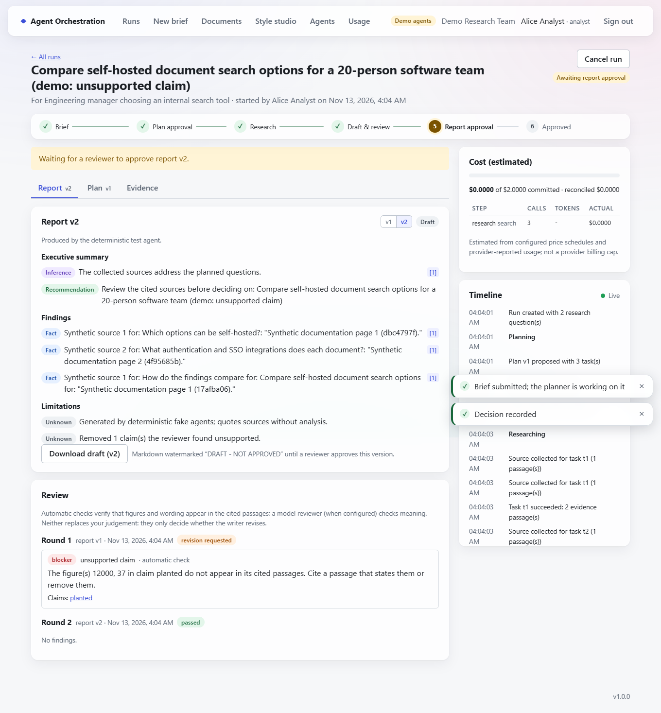
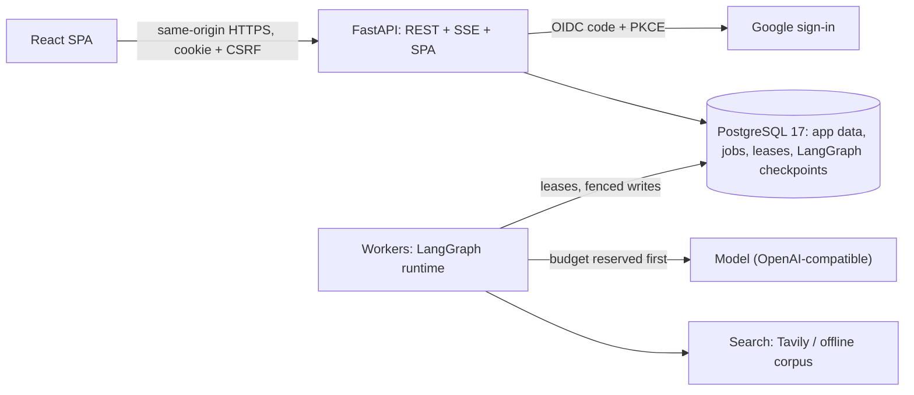

# Agent Orchestration System

**Four AI agents research a question, cite their sources and review each other's work, and a
person approves the plan and the final report before anything leaves the system.**

[](https://github.com/Charanloyal/Agent-Orchestration-System-/actions/workflows/ci.yml)
[](LICENSE)

**Live demo:** https://aos-web-8b4t.onrender.com (free Render instance: the first request after
15 idle minutes takes up to a minute; sign-in is by invitation or access request). 15-credit
AI/ML major project.



## How it works

```text
brief ──▶ planner ──▶ [HUMAN: approve plan] ──▶ researchers (parallel, bounded)
      ──▶ writer (cited draft) ──▶ reviewer (≤ 2 revision rounds)
      ──▶ [HUMAN: approve this exact report version] ──▶ export
```

| Agent | Does | Guarded by |
| --- | --- | --- |
| **Planner** | Turns the brief into a typed plan of research tasks | JSON-schema contract; a person approves or edits it |
| **Researcher** (×N) | Searches, fetches and extracts evidence for one task | SSRF-safe fetcher, domain policy, budget reserved before every call |
| **Writer** | Drafts the report; every factual sentence cites evidence | Citations validated against this run's evidence only |
| **Reviewer** | Finds unsupported claims, figures and gaps; requests revisions | Deterministic checks plus the model; at most 2 rounds |

The two **human approval gates** bind to a version and a digest: approving plan v2 never
approves an edited v3, and the export records who approved which exact report.

**Style studio.** A separate page measures any pasted text or uploaded document (sentence-length
variation, vocabulary diversity, stock phrases per 1,000 words) and rewrites it for a journalist,
academic, executive or technical reader. Numbers, dates, quotes, citations and links are locked, so
a change that would alter one is rejected. The metrics describe the text; they do not predict who
or what wrote it, and the feature makes no detector-evasion claims
([ADR 0027](docs/decisions/0027-style-studio-honest-metrics.md)).



PostgreSQL is the only coordination medium: no message broker. Workers survive crashes
(leases, fencing tokens, checkpoints), and a run waiting for a person holds no worker.
Details: [final report §7–8](docs/report/final-report.md).

## Evaluation

Three systems on the same briefs ([evaluation plan](docs/evaluation/evaluation-plan.md),
[ADR 0017](docs/decisions/0017-evaluation-harness.md)): **A** multi-agent with reviewer,
**B** single-agent baseline, **C** multi-agent with a pass-through reviewer.

| Measured (fake agents, harness validation; 30 runs per system) | A | B | C |
| --- | --- | --- | --- |
| Outcome matches expected | 28/30 (93%; 95% CI 79–98%) | 28/30 | 28/30 |
| Citation validity | 70/70 (100%; 95–100%) | 56/56 | 70/70 |
| Operational failures | 0/30 | 0/30 | 0/30 |
| Human gate bypassed / injected URL fetched | 0/30 / 0/30 | 0/30 / 0/30 | 0/30 / 0/30 |

These numbers validate the harness, **not model quality**: fake agents produce identical
content for A, B and C by construction. **Live-model results: PENDING (needs owner):** a
written budget (≤ USD 10, [ADR 0005](docs/decisions/0005-spending-ceiling.md)), then the dev
and held-out runs and two blind human scorers. The tooling is built and tested.

## Tech stack

Python 3.14 · FastAPI · LangGraph · SQLAlchemy + Alembic · PostgreSQL 17 · React 19 +
TypeScript + Vite · TanStack Query · Playwright + axe-core · Docker · Render · GitHub Actions.

## Quick start (local, fake agents, no keys)

```powershell
Copy-Item .env.example .env                                   # set POSTGRES_PASSWORD (git-ignored)
docker compose up --build -d                                  # Postgres, API, worker, dev sign-in, web
docker compose exec api python -m app.cli seed-demo --sample-run   # demo users and one sample run
```

Open http://localhost:8080 and sign in as **Alice Analyst** (the bundled dev identity
provider; local only). No Docker? The native setup (Windows PowerShell) is in sections 1–3
below.

## Documentation map

| For | Read |
| --- | --- |
| Users | [User guide](docs/user-guide.md) · [Troubleshooting](docs/troubleshooting.md) |
| The viva | [5-minute demo script](docs/demo/demo-script.md) · [Final report](docs/report/final-report.md) |
| Operators | [Deploy to Render](docs/operations/deploy-render.md) · [Runbook](docs/operations/runbook.md) · [P0 checklist](docs/operations/p0-checklist.md) |
| Design | [Docs index and all ADRs](docs/README.md) · [Threat model](docs/security/threat-model.md) |

> **Status (v1.0 release candidate):** the repository side is complete and tested (backend,
> frontend, end-to-end and accessibility tests; CI builds the production image and smoke-tests
> every Render topology). **Not yet:** the Render deployment, the rollback rehearsals, the
> live-model evaluation and the user research, which need the owner's accounts, budget and
> participants; each has a written procedure. See [docs/handoff.md](docs/handoff.md).

**What a visitor gets:** "Continue with Google" sign-in; invitations by workspace admins;
a request-access form reviewed by platform admins; role-based workspaces (analyst, reviewer,
admin); notifications for every action; friendly messages for every sign-in and permission
problem; dark mode; layouts down to 360 px; and every page checked with axe-core for WCAG
2.2 A/AA on each test run.

## Repository layout

```text
backend/                  FastAPI API, workers, agents, contracts, Alembic migrations, tests
backend/devtools/         Local dev OIDC issuer (never used in prod)
frontend/                 React + TypeScript + Vite single-page app (same-origin API proxy)
docs/                     Product, evaluation, security and architecture docs; ADRs; JSON Schemas
eval/                     Evaluation briefs (dev frozen at eval-dev-v1; held-out), offline corpus v1, results
backend/evaluation/       Evaluation harness: systems A/B/C, metrics, blind scoring kit (ADR 0017)
spikes/week2_persistence/ Archived Week-2 spike (evidence for ADR 0007/0008)
docker-compose.yml        Local production-like stack (Postgres, API, dev IdP, web)
Dockerfile, render.yaml   Single-origin production image and Render Blueprint (web + worker + Postgres)
render.hybrid.yaml        Chosen variant: one free service runs API and worker, paid Postgres (ADR 0023)
render.free.yaml          Free-plan variant: as hybrid, with a free Postgres (ADR 0022)
.github/workflows/ci.yml  Lint, type-check, tests on Postgres, frontend build, image builds
```

## Prerequisites

| Tool | Version verified | Notes |
| --- | --- | --- |
| Python | 3.14.7 | |
| Node.js | 24.21.0 LTS (npm 11.19.0) | Vite 8 needs Node `^20.19.0 \|\| >=22.12.0` |
| PostgreSQL | 17.11 | Native install, portable zip, or Docker |
| Docker (optional) | Compose v2 | Only for `docker compose up` |

Commands are for **Windows PowerShell**; macOS/Linux equivalents are at the end.

> **Windows:** the default execution policy blocks `npm.ps1`, so use `npm.cmd`.

## 1. Database

Any PostgreSQL 17 works. With the portable EnterpriseDB zip extracted to
`%LOCALAPPDATA%\Programs\postgresql-17` (no admin rights or Windows service needed; see the
[threat model](docs/security/threat-model.md#local-development-notes-current-state) about
binary verification):

```powershell
$bin  = "$env:LOCALAPPDATA\Programs\postgresql-17\pgsql\bin"
$data = "$env:LOCALAPPDATA\aos-pg\data"
& "$bin\initdb.exe" -D $data -U postgres --pwprompt --auth=scram-sha-256 --encoding=UTF8 --locale=C
Add-Content "$data\postgresql.conf" "`nlisten_addresses = '127.0.0.1'`nport = 54329`n"
& "$bin\postgres.exe" -D $data                      # keep running in its own terminal
& "$bin\psql.exe" -h 127.0.0.1 -p 54329 -U postgres -c "CREATE DATABASE aos" -c "CREATE DATABASE aos_test"
```

Create `backend/.env`. It is **git-ignored; never commit it**.

```text
AOS_DATABASE_URL=postgresql://postgres:<password>@127.0.0.1:54329/aos
AOS_TEST_DATABASE_URL=postgresql://postgres:<password>@127.0.0.1:54329/aos_test
```

## 2. Backend

```powershell
cd backend
python -m venv .venv
.\.venv\Scripts\python.exe -m pip install -r requirements-dev.txt
.\.venv\Scripts\python.exe -m alembic upgrade head          # create/upgrade the schema
.\.venv\Scripts\python.exe -m app.cli seed-demo             # demo workspaces + users (dev only)
.\.venv\Scripts\python.exe -m uvicorn app.main:app --host 127.0.0.1 --port 8000 --reload
```

In a second terminal, start the **local dev identity provider**. It offers the demo users
Alice/analyst, Bob/reviewer, Carol/admin and Mallory/other workspace, plus Dana and Erin, who
are not seeded, for trying invitations and access requests:

```powershell
cd backend
.\.venv\Scripts\python.exe -m devtools.dev_oidc             # http://127.0.0.1:8001
```

In a third terminal, start a **workflow worker**. Add more workers for parallelism; they
coordinate through PostgreSQL leases.

```powershell
cd backend
.\.venv\Scripts\python.exe -m app.workers.runner
```

Agents are deterministic fakes by default (`AOS_AGENT_MODE=fake`), so the whole workflow runs
without any model provider or cost.

| Endpoint | Purpose |
| --- | --- |
| `GET /healthz` | Liveness, with the release version and short commit (shown in the UI footer) |
| `GET /readyz` | Readiness (database reachable, schema at the code's head or a newer compatible one; ADR 0020) |
| `GET /version` | Serving build: version, commit, migration head |
| `GET /api/docs` | Interactive OpenAPI docs (disabled in prod) |
| `GET /api/v1/auth/config` | Public: provider label and signup mode for the sign-in page |
| `GET /api/v1/auth/login` | Start OIDC sign-in |

**Checks** (the same commands CI runs):

```powershell
.\.venv\Scripts\python.exe -m ruff check app devtools evaluation tests scripts migrations\env.py
.\.venv\Scripts\python.exe -m ruff format --check app devtools evaluation tests scripts migrations\env.py
.\.venv\Scripts\python.exe -m mypy
.\.venv\Scripts\python.exe -m pytest -q
```

Database tests use `AOS_TEST_DATABASE_URL`. That database is **dropped and rebuilt** by the
tests, so never point it at real data. Without it, database tests are skipped, not passed.

After changing a contract in `app/contracts/`, regenerate the checked-in JSON Schemas:
`.\.venv\Scripts\python.exe -m scripts.export_schemas`. A drift test enforces this.

After changing a model in `app/db/models/`, create a migration with
`.\.venv\Scripts\python.exe -m alembic revision --autogenerate -m "<what changed>"` and
review it. A test fails if the models and migrations differ.

## 3. Frontend

```powershell
cd frontend
npm.cmd ci
npm.cmd run dev        # http://127.0.0.1:5173 (proxies /api to the backend)
npm.cmd run typecheck  # app + end-to-end test sources
npm.cmd test           # Vitest unit tests
npm.cmd run build      # production bundle
```

Open <http://127.0.0.1:5173> and sign in as Alice to submit a brief. Approve the plan as
Alice, then sign in as Bob to review the cited report and approve it.

### End-to-end tests (Playwright)

The E2E suite starts an **isolated stack** (dev IdP on 8101, API on 8100, a worker, Vite on
5180) against a dedicated database, which it **wipes and re-seeds**. Add it to `backend/.env`:

```text
AOS_E2E_DATABASE_URL=postgresql://postgres:<password>@127.0.0.1:54329/aos_e2e
```

```powershell
npm.cmd run e2e        # uses installed Microsoft Edge locally; CI uses Playwright's Chromium
```

The suite runs the workflow journeys, the access model (invitation, access request,
session expiry), and an accessibility pass over every page: axe-core WCAG 2.2 A/AA in light
and dark mode, a 360 px layout check, and a keyboard test. The E2E stack uses
`AOS_SIGNUP_MODE=request` with Carol as platform admin.
`$env:AOS_SCREENSHOTS=1; npm.cmd run e2e` also refreshes the documentation screenshots.

## 4. Docker Compose (optional, production-like)

```powershell
Copy-Item .env.example .env        # set POSTGRES_PASSWORD; .env is git-ignored
docker compose up --build          # http://localhost:8080 , dev IdP on http://localhost:8001
```

Both ports bind to 127.0.0.1 only. CI builds these images on every push.

### Single-origin production image (what Render runs)

The root [`Dockerfile`](Dockerfile) builds one image: the API also serves the built web app,
and the same image runs the worker. It contains no dev issuer. Without Docker, the same
arrangement runs natively; this mirrors CI's `deploy-image` job:

```powershell
cd frontend; npm.cmd run build; cd ..\backend
$env:AOS_STATIC_DIR = (Resolve-Path ..\frontend\dist).Path
.\.venv\Scripts\python.exe -m uvicorn app.main:app --port 8000   # http://127.0.0.1:8000 serves app + API
```

To sign in on this single origin, start both the API and the dev issuer with
`$env:AOS_PUBLIC_URL = "http://127.0.0.1:8000"`. The dev issuer only accepts the callback
`<AOS_PUBLIC_URL>/api/v1/auth/callback`.

## 5. Demo and deployment

- **Demo:** `python -m app.cli seed-demo --sample-run`, then follow the 10-step
  [demonstration script](docs/demo/demo-script.md). The [user guide](docs/user-guide.md)
  explains each screen.
- **Render:** [`render.hybrid.yaml`](render.hybrid.yaml) (one free service, paid Postgres;
  the chosen topology), [`render.yaml`](render.yaml) (web + worker + Postgres, paid) or
  [`render.free.yaml`](render.free.yaml) (all free), with Google sign-in, step by step
  in [deploy-render.md](docs/operations/deploy-render.md). After every deploy run
  `python backend/scripts/smoke_prod.py https://<your-url>`.
- **Operations:** [P0 checklist](docs/operations/p0-checklist.md) ·
  [migrations and rollback](docs/operations/migrations.md) ·
  [data retention](docs/operations/data-retention.md) · [runbook](docs/operations/runbook.md).

## Configuration

All settings are environment variables prefixed with `AOS_`, defined in
[backend/app/config.py](backend/app/config.py). Secrets are typed `SecretStr` and never
logged. `AOS_ENV=prod` enforces secure cookies and HTTPS URLs for the public site and the
issuer.

| Variable | Default | Purpose |
| --- | --- | --- |
| `AOS_DATABASE_URL` | none | PostgreSQL URL |
| `AOS_PUBLIC_URL` | `http://127.0.0.1:5173` | Browser-facing origin (CSRF Origin check, OIDC redirect) |
| `AOS_OIDC_ISSUER` | `http://127.0.0.1:8001` | OIDC issuer (dev issuer by default) |
| `AOS_OIDC_CLIENT_ID` / `AOS_OIDC_CLIENT_SECRET` | `aos-local` / none | Client registration (the secret is for Google or Entra) |
| `AOS_OIDC_BACKCHANNEL_URL` | none | Internal issuer URL for server-to-server calls |
| `AOS_COOKIE_SECURE` | `false` | Must be `true` in prod |
| `AOS_AGENT_MODE` | `fake` | `fake` (deterministic, free) or `llm` (real model; see "Live model" below) |
| `AOS_SEARCH_PROVIDER` | `fake` | `fake`, `corpus` (offline, versioned, free) or `tavily` (live; needs `AOS_TAVILY_API_KEY`) |
| `AOS_TAVILY_API_KEY` | none | Tavily key (secret; `.env` only) |
| `AOS_OBJECT_STORE_DIR` | `backend/.data/objects` | Local object storage for uploads (git-ignored) |
| `AOS_UPLOAD_MAX_BYTES` / `AOS_FETCH_MAX_BYTES` | 10 MB / 2 MB | Upload and fetched-page size limits |
| `AOS_PRICE_LLM_INPUT_PER_MILLION` / `AOS_PRICE_LLM_OUTPUT_PER_MILLION` / `AOS_PRICE_SEARCH_PER_CREDIT` | 0.15 / 0.60 / 0.008 USD | Price schedule for *estimated* cost (verify current prices; set `AOS_PRICE_SCHEDULE_ID` when you change them) |
| `AOS_WORKER_LEASE_SECONDS` / `AOS_WORKER_HEARTBEAT_SECONDS` | `30` / `10` | Job lease and heartbeat |
| `AOS_JOB_MAX_ATTEMPTS` | `5` | Transient-retry budget per segment |
| `AOS_APPROVAL_TTL_HOURS` | `72` | How long a plan or report waits for a human |
| `AOS_OTEL_EXPORTER` / `AOS_OTEL_ENDPOINT` | `none` / `http://127.0.0.1:4318/v1/traces` | Traces: `none`, `console` or `otlp` (redacted; [ADR 0016](docs/decisions/0016-observability-rate-limits.md)) |
| `AOS_METRICS_TOKEN` | none | Bearer token for `/metrics` (required in prod, otherwise the endpoint is hidden there) |
| `AOS_RATE_*` | 20 runs/user/h, 60 runs/workspace/h, 30 uploads/h, 60 exports/h, 120 style studio calls/h, 30 logins/5 min | Rate limits (`0` disables one) |
| `AOS_BREAKER_FAILURE_THRESHOLD` / `AOS_BREAKER_COOLDOWN_SECONDS` | `5` / `60` | Provider circuit breaker |
| `AOS_ALLOWED_EMAILS` / `AOS_ALLOWED_EMAIL_DOMAINS` | empty | Always allowed to sign in (matched on the provider's *verified* email) |
| `AOS_PLATFORM_ADMIN_EMAILS` | empty | Who manages access for the whole deployment; **required in prod** ([ADR 0021](docs/decisions/0021-access-model.md)) |
| `AOS_SIGNUP_MODE` | `open` in dev without an allowlist, else `invite` | `invite`, `request` (public request form) or `open` (refused in prod with model agents) |
| `AOS_WORKSPACE_CREATION` | `everyone` in dev, `platform_admins` in prod | Who may create workspaces |
| `AOS_INVITATION_TTL_DAYS` | `14` | Invitation lifetime |
| `AOS_OIDC_PROVIDER_LABEL` | derived from the issuer | Name on the "Continue with …" button (Google and Microsoft are recognised) |
| `AOS_RATE_ACCESS_REQUEST_PER_IP_HOUR` | `5` | Access requests per client address per hour |
| `AOS_RETENTION_ACCESS_REQUEST_DAYS` | `90` | Decided access requests are deleted after this |
| `AOS_STATIC_DIR` | unset | Serve the built SPA from the API (single origin; set in the production image) |
| `AOS_MAX_REQUEST_BYTES` | `1000000` | Largest JSON request body (uploads: `AOS_UPLOAD_MAX_BYTES` + 1 MB) |
| `AOS_RETENTION_RUN_DAYS` / `AOS_RETENTION_UPLOAD_DAYS` | `0` (off) | Retention sweep for finished runs and uploads ([policy](docs/operations/data-retention.md)) |

With `AOS_ENV=prod` the API and worker **refuse to start** on unsafe settings: the dev
issuer, http URLs, insecure cookies, no platform admin, open signup with model agents, a
missing database URL. The error names each variable to fix.

Operations: [alert rules](docs/operations/alerts.yml) and the [incident runbook](docs/operations/runbook.md).

## Live model and search (optional, costs money)

Everything runs on deterministic fakes by default. To use a real model, add the settings to
`backend/.env`. The project ceiling is **USD 10** ([ADR 0005](docs/decisions/0005-spending-ceiling.md)).

```text
AOS_AGENT_MODE=llm
# OpenAI:
AOS_LLM_API_KEY=<key>
AOS_LLM_MODEL=gpt-4o-mini
# ...or Groq: AOS_LLM_BASE_URL=https://api.groq.com/openai/v1 and a Groq model name
# ...or local Ollama (free): AOS_LLM_BASE_URL=http://127.0.0.1:11434/v1, AOS_LLM_MODEL=llama3.1
# ...or Azure OpenAI: AOS_LLM_API_STYLE=azure, AOS_LLM_AZURE_ENDPOINT=..., AOS_LLM_MODEL=<deployment>
AOS_SEARCH_PROVIDER=tavily
AOS_TAVILY_API_KEY=<key>
```

Opt-in live smoke test (one small planner call): `$env:AOS_LIVE_TESTS="1"; .\.venv\Scripts\python.exe -m pytest -m live -s tests/live`.

On Render, keys go in the service's environment, never in the repository; follow
[deploy-render.md §6](docs/operations/deploy-render.md#6-optional-switch-the-hosted-app-to-a-live-model).

### Evaluation

From `backend/`, with `AOS_EVAL_DATABASE_URL` set to an empty, dedicated database:

```text
.\.venv\Scripts\python.exe -m evaluation.run                              # dev split, systems A/B/C, fake agents
.\.venv\Scripts\python.exe -m evaluation.blind ..\eval\results\<folder>   # blind human-scoring kit
```

Results go to [eval/results](eval/results/README.md). Live runs (`--live --budget`) and the
held-out split (`--confirm-heldout`) are guarded; follow the checklist in the
[evaluation plan](docs/evaluation/evaluation-plan.md#live-run-checklist-costs-money-adr-0005).

### Seeing the reviewer work without a model

With the default fake agents, put `(demo: unsupported claim)` anywhere in a brief's topic.
Report v1 then contains one fabricated figure. The deterministic check flags it as a
blocker, the writer revises, and round 2 passes. The **Review** panel shows the finding and
can jump to the flagged claim in v1. Use **Download draft** or **Download approved report**
on the Report tab for the Markdown export ([ADR 0014](docs/decisions/0014-writer-reviewer-export.md)).

## Corporate proxies and package mirrors

`pip` and `npm` cannot authenticate to NTLM/Kerberos proxies. If installs fail with
`407 Proxy Authentication Required`, use your organization's package mirror:

```powershell
.\.venv\Scripts\python.exe -m pip config --site set global.index-url <pypi-mirror-simple-url>
npm.cmd config set registry <npm-mirror-url>
```

## macOS / Linux

Replace `.\.venv\Scripts\python.exe` with `.venv/bin/python` and `npm.cmd` with `npm`.

## Documentation

[docs/README.md](docs/README.md) indexes the product brief, evaluation plan, threat model,
architecture and all decision records. For users: [user guide](docs/user-guide.md) and
[troubleshooting](docs/troubleshooting.md).
