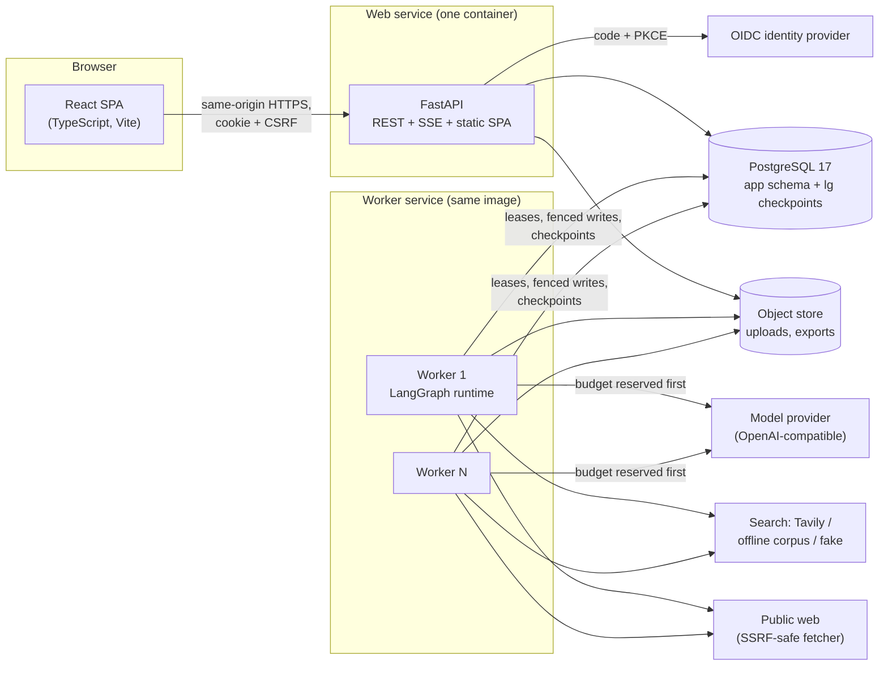
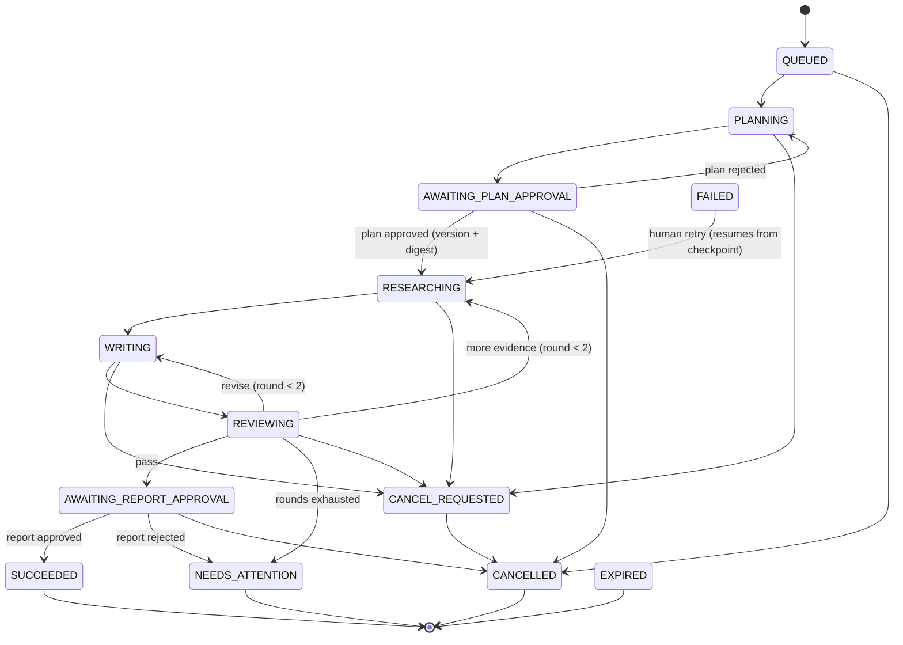
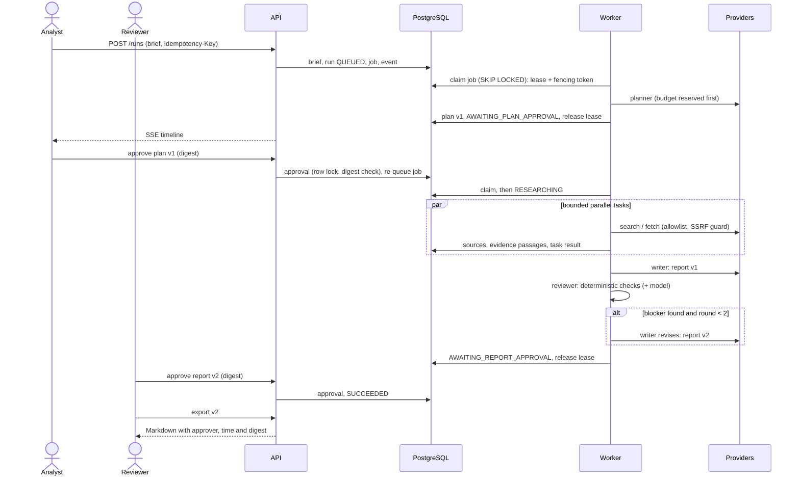
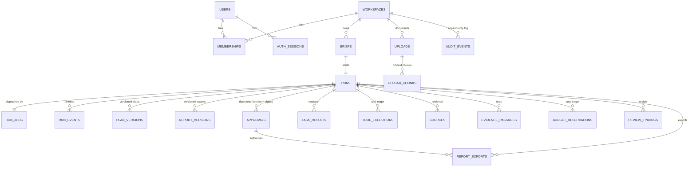

# Agent Orchestration System: evidence-backed multi-agent research with human approval

**Final project report** · BSc final-year project (15 credits) · November 2026

Repository: `Charanloyal/Agent-Orchestration-System-` · Appendices: [appendices.md](appendices.md)

---

## Abstract

Large language models can draft research reports quickly. However, their output often
contains statements that the cited sources do not support. It is also hard to tell how a
multi-step "agent" reached its answer. This project designed and built the **Agent
Orchestration System**, a web application in which four agents (planner, researcher, writer
and reviewer) are coordinated by one explicit, durable workflow. Two human decisions are
part of that workflow:

- an analyst approves the research plan before any research is done;
- a reviewer approves the exact final report version before it can be exported as approved.

Every claim in a report is typed (fact, inference, recommendation, conflict or unknown) and
cites stored evidence passages. A reviewer stage checks the claims and can send the draft
back for at most two revision rounds.

The system is built with FastAPI, PostgreSQL, LangGraph and React. Workers coordinate through
leases with fencing tokens, budgets are reserved before every billable call, and workspaces
are isolated by authorization checks on every route. Sign-in uses OpenID Connect.

Verification is automated:

- 398 backend tests, 35 frontend unit tests and 6 browser end-to-end tests;
- a 10-point crash-recovery suite;
- a load test (20 concurrent clients, p95 158 ms, 0 errors, on one laptop with fake
  providers);
- a backup-and-restore drill that passed;
- an evaluation harness comparing the orchestrated system (A), a single-agent baseline (B)
  and a reviewer-removed ablation (C) on 20 frozen development cases.

The only evaluation run so far used deterministic fake agents. It validates the harness, not
report quality: under fake agents, A, B and C differ only mechanically. The live-model
evaluation, the held-out run and blind human scoring were not performed, because they need a
paid API key, a budget approval and two human scorers. **This report therefore makes no claim
that orchestration improves report quality.** It contributes a working, tested platform and
an evaluation method that is ready to answer that question.

---

## 1. Introduction

Retrieval-augmented generation [2] and tool-using agents [1] let language models consult
sources. Multi-agent frameworks [3][10] split work between specialised roles. Two problems
remain for anyone who must *rely* on the output:

1. **Verifiability.** Audits of commercial generative search engines found that only 51.5% of
   generated sentences were fully supported by their citations, and only 74.5% of citations
   supported their sentence [7]. On the ALCE benchmark, even the best models of the time
   lacked complete citation support 50% of the time on ELI5 [5].
2. **Control and reliability.** Multi-agent systems fail in recurring ways: poor system
   design, misaligned agents and weak verification. Their gains over single agents on popular
   benchmarks are often minimal [11]. In production, long-running agent work also faces
   ordinary distributed-systems failures: crashed workers, duplicated work, runaway spending
   and concurrent edits.

This project treats the second problem as an engineering problem and makes the first
measurable. The workflow is not left to free agent conversation. It is a typed state machine
with explicit transitions, persisted artifacts and human gates. The question of whether four
agents beat one is left to a controlled comparison, not assumed.

**Report structure.** Sections 2–4 define the problem, objectives and scope. Section 5
reviews background work. Sections 6–11 describe requirements, architecture, workflow, data,
security and implementation. Sections 12–14 describe the evaluation and its actual results.
Sections 15–17 discuss limitations, future work and conclusions.

**Statement on AI assistance.** The implementation, tests and documentation were produced with
the help of an AI coding assistant working under the author's direction. The same assistant
also wrote the held-out evaluation cases (Section 15). All results in this report come from
commands that were actually run; their outputs are recorded in the repository (Appendix C).

## 2. Problem statement

Analysts who prepare decision briefs (for example, "compare self-hosted document search
options for a 20-person team") must:

- break a question into sub-questions;
- find evidence;
- reconcile conflicting or stale sources;
- make sure every claim is supported.

A single generated answer hides each of these steps and its failures. The *hypothesis*,
which has not been validated with users (user interviews were not carried out; Section 15),
is that a reviewable, evidence-linked report produced by a controlled workflow is more
trustworthy and easier to check than a one-shot answer.

The engineering problem is to build such a workflow so that:

- every verifiable claim is traceable to a stored passage, and unsupported claims are caught
  before a human sees the final version;
- humans keep authority: no research before plan approval, and no "approved" export without
  approval of that exact version;
- execution is bounded (deadline, tool calls, parallelism, review rounds, money) and survives
  crashes without losing or duplicating committed work;
- tenants (workspaces) cannot see each other's data, even through guessed identifiers or
  shared search indexes.

## 3. Objectives

| # | Objective | Measured by |
| --- | --- | --- |
| O1 | Structured reports in which every verifiable claim cites run evidence and uncertainty is explicit | Citation validation on every draft; claim-kind contract; evaluation metrics |
| O2 | Human approval of the exact plan and report versions | Version- and digest-bound approval tests; E2E tests |
| O3 | Durable, bounded execution | 10-point crash suite; budget race tests; limit tests |
| O4 | Workspace isolation and secure defaults | Route-generated authorization matrix; SSRF suite; production safety checks |
| O5 | Observable runs and costs | Timeline/SSE tests; usage ledger; metrics and traces tests |
| O6 | A fair comparison of orchestrated vs single-agent vs no-reviewer systems | Evaluation harness with frozen data, blind scoring kit, Wilson intervals |
| O7 | Deployable, documented pilot | Production image smoke-tested in CI; Render Blueprint; runbooks; user guide |

O1–O5 and O7 were met on the repository side (Section 13). O6 is **partly met**: the harness
exists and is validated, but the live comparison has not been run (Section 14).

## 4. Scope

**In scope (pilot P0):**

- sign-in and workspace roles;
- brief submission;
- plan and report approvals;
- one search adapter with safe fetching;
- text and text-PDF ingestion;
- evidence storage and citation checking;
- report versions and Markdown export;
- durable execution with retries, cancellation and bounded revision;
- timeline, logs, cost ledger and automated evaluation.

**Out of scope:**

- a general chat assistant or arbitrary tools or code execution;
- browser automation, OCR or scanned PDFs;
- billing, scheduling, enterprise connectors and multi-region deployment.

**Pilot domain:** software tooling and vendor comparisons. Public sources exist for this
domain, conflicts and stale pages are common, an engineer can judge the answers, and no
confidential data is needed.

## 5. Literature and background review

### 5.1 Language-model agents and multi-agent systems

- **Reasoning and acting.** ReAct interleaves reasoning traces with actions such as search,
  letting a model gather information while it reasons [1].
- **Self-improvement.** Reflexion [9] and Self-Refine [4] show that a model can improve its
  output from verbal feedback, either reflecting on failed attempts or critiquing and
  refining its own drafts.
- **Multi-agent frameworks.** AutoGen provides conversable agents that cooperate through
  messages [3]. MetaGPT encodes standard operating procedures into role-specialised agents
  with structured intermediate outputs [10]. A survey by Wang et al. [13] organises the field
  by agent construction, application and evaluation.

**Critical view.** Cemri et al. analysed over 1,600 annotated traces from seven multi-agent
frameworks. They found that performance gains are often minimal and identified 14 failure
modes in three groups: system design, inter-agent misalignment and task verification [11].

This motivated three choices:

1. a fixed, typed workflow instead of free conversation (addressing design and misalignment
   failures);
2. a dedicated reviewer with deterministic checks (addressing verification failures);
3. a mandatory single-agent baseline and a reviewer ablation in the evaluation.

The design adopts the *idea* of self-refinement [4][9], but bounds it to two rounds and makes
running out of rounds an explicit outcome (`NEEDS_ATTENTION`).

### 5.2 Grounding, citation and factuality

Retrieval-augmented generation conditions generation on retrieved passages [2]. Hallucination
(fluent but unsupported content) is widespread across generation tasks [8].

Evaluation work has made support measurable:

- ALCE scores fluency, correctness and citation quality automatically [5];
- FActScore splits long text into atomic facts and measures the share supported by a
  knowledge source [12];
- Liu et al. audited citation recall and precision of generative search engines with human
  raters [7].

This project borrows the claim-level view: each statement is a typed claim with citations.
It uses two layers of checks:

1. **deterministic:** every cited ID must belong to the run's authorised evidence, and figures
   and key wording must appear in the cited passage;
2. **semantic:** a model reviewer, when configured.

Semantic support is ultimately scored by blind human raters, not by a model judge.

### 5.3 Security of LLM-integrated applications

Indirect prompt injection plants instructions in content that an application will later
retrieve [6]. This is the central threat for any research agent that reads the web. The OWASP
Top 10 for LLM Applications [14] lists prompt injection, sensitive information disclosure,
excessive agency and unbounded consumption among its main risks. The NIST AI Risk Management
Framework [15] frames these as risks to govern, map, measure and manage.

The design response is to **keep authority outside the model**:

- the tool allowlist, network destinations and budget are enforced in code;
- retrieved text is treated as data;
- the LLM researcher has no tools at all.

### 5.4 Human oversight

Parasuraman, Sheridan and Wickens describe levels of automation across four functions:
information acquisition, analysis, decision selection and action implementation [16]. In those
terms, this system automates acquisition and analysis but keeps *decision selection* (plan and
report approval) with humans.

Amershi et al.'s guidelines for human-AI interaction [17] influenced the interface:

- make clear what the system can do and how well (the "Demo agents" badge, claim kinds);
- support efficient correction (plan editing, rejection with comments);
- show why the system did something (timeline, cited passages, review findings).

### 5.5 Durable execution and coordination

- **Leases** are time-bounded grants that tolerate holder failure [18].
- A paused process can wake after its lease has expired. **Fencing tokens** (monotonically
  increasing numbers that every write must present) stop such a process from overwriting
  newer state [19].
- Long-lived work can be structured as **sagas**: sequences of committed steps rather than one
  transaction [20].
- LangGraph provides graph-structured agent workflows with checkpointing and human-in-the-loop
  interrupts [21].

The project combines these:

- LangGraph checkpoints run inside a fenced PostgreSQL saver, and each step commits its
  artifacts transactionally;
- PostgreSQL's `FOR UPDATE SKIP LOCKED` [22] lets many workers claim jobs without blocking
  each other.

### 5.6 Identity, statistics and accessibility

Sign-in follows OpenID Connect Core [23], using the authorization-code flow with PKCE [24]
and the OAuth 2.0 security best current practice [25].

For evaluation:

- proportions are reported with Wilson score intervals [26], which behave well for small
  samples and for proportions near 0 or 1;
- agreement between the two human scorers is reported with Cohen's κ [27].

Interface accessibility follows WCAG 2.2 [28] as a design target. It has not been audited
(Section 15).

## 6. System requirements

The functional requirements (FR) and release gates are tracked in the
[acceptance criteria matrix](../product/acceptance-criteria.md). Summary:

| ID | Requirement | Status |
| --- | --- | --- |
| FR-01 | Every resource authorised server-side by workspace; guessed IDs and cross-workspace search fail | Verified |
| FR-02 | Idempotent brief creation; invalid limits rejected | Verified |
| FR-03 | Plans validated (cycles, references, tools, limits); planner cannot widen the allowlist | Verified |
| FR-04 | Approvals bind to version and digest; edits need new approval; rejected reports never exported as approved | Verified |
| FR-05 | Sources keep stable ID, URL, retrieval time, hash, publication date; failed fetches never shown as read; SSRF blocked | Verified |
| FR-06 | Claims cite run evidence; claim kinds distinguished | Verified (deterministic); semantic quality open |
| FR-07 | Citation validation; at most 2 review rounds | Verified |
| FR-08 | Crashes neither lose nor duplicate committed work; stale workers cannot write | Verified |
| FR-09 | Spend reserved before calls; limits hold under concurrency | Verified |
| FR-10 | Live progress with replay; cooperative cancellation | Verified |
| FR-11 | Immutable versions; server-side approved export; audit without secrets | Verified |
| FR-12 | Retention and deletion | Verified |

**Non-functional targets** (proposed release gates):

- API p95 below 500 ms for metadata endpoints at 20 concurrent clients;
- 5 concurrent runs without corruption;
- 10/10 crash scenarios recovered;
- 100% citation-ID validity;
- at least 90% of sampled claims supported, scored by humans;
- at least 90% completion on answerable briefs.

The first four were met locally. The last two need the live evaluation.

## 7. Architecture and design decisions

### 7.1 Components

- **API and workers are separate processes** built from the same image. Human waits hold no
  worker: a run waiting for approval has no lease. Approval re-queues the job.
- **PostgreSQL is the only coordination medium.** It holds jobs, leases, events (for SSE),
  rate-limit counters, budget reservations and LangGraph checkpoints. No message broker is
  needed, which keeps the pilot to two services and one database.
- **Same-origin deployment.** In production, the API serves the built SPA. Cookies are
  `SameSite`, CORS is unnecessary, and the content security policy is strict.

### 7.2 Decision records

Nineteen Architecture Decision Records document the design ([index](../README.md)). The
most consequential are:

| ADR | Decision | Main alternative rejected and why |
| --- | --- | --- |
| [0006](../decisions/0006-workflow-and-contracts.md) | Explicit state machine with typed Pydantic contracts and drift-checked JSON Schemas | Free agent conversation: unbounded and hard to audit [11] |
| [0007](../decisions/0007-checkpoint-persistence-and-fencing.md) | LangGraph checkpoints in PostgreSQL behind a fenced saver | Unfenced checkpointer: a stale worker could overwrite progress (shown by spike S3) |
| [0008](../decisions/0008-job-leasing-and-dispatch.md) | PostgreSQL job table with leases and `SKIP LOCKED` | Separate queue (Redis or Celery): more moving parts, and a second source of truth |
| [0009](../decisions/0009-identity-sessions-authorization.md) | OIDC + PKCE, server-side sessions, one permission table, 404 for non-members | JWT in local storage: XSS-exposed and hard to revoke |
| [0013](../decisions/0013-parallel-research-budgets.md) | Transactional budget reservation before every billable call | Post-hoc accounting: cannot stop concurrent overspend |
| [0014](../decisions/0014-writer-reviewer-export.md) | Two-layer reviewer; bounded rounds; server-side export bound to digest | Model-only review: unverifiable and costly |
| [0015](../decisions/0015-cancel-retry-recovery.md) | Cooperative cancellation at boundaries; human-only retry from checkpoint | Killing threads: leaves calls and reservations undefined |
| [0017](../decisions/0017-evaluation-harness.md) | Frozen dev set, offline corpus, A/B/C through the real workflow, blind human scoring | Model-as-judge: not trusted as sole authority |
| [0018](../decisions/0018-production-image-render-hardening.md) | Single-origin image; production refuses unsafe settings | Separate static host: CORS and cookie complexity |
| [0019](../decisions/0019-data-lifecycle-audit.md) | Admin deletion, retention sweep, append-only audit by database trigger | Soft delete only: keeps personal data indefinitely |

## 8. Workflow and agent coordination

### 8.1 State machine

The run state machine lives in `backend/app/contracts/run_state.py`. Every transition is
checked against `ALLOWED_TRANSITIONS`, and any other transition raises `InvalidTransition`.

The diagram omits some edges for readability:

- any active state can go to `FAILED` or `EXPIRED`;
- both approval waits expire after the approval time-to-live (72 h by default);
- a human retry returns a `FAILED` run to *whichever* state it failed in (`QUEUED`,
  `PLANNING`, `RESEARCHING`, `WRITING` or `REVIEWING`), at most 3 times;
- terminal states have no outgoing transitions, except `FAILED`, which is reachable only by
  a human retry.

### 8.2 Agents and their contracts

| Agent | Input | Output contract | Key constraint |
| --- | --- | --- | --- |
| Planner | Brief | `Plan`: tasks with dependencies, allowed tools, outline | Validated against `PlanPolicy` from the brief; cannot add tools; no cycles |
| Researcher | One task + collected passages | `ResearcherOutput`: evidence IDs used, unresolved questions | Has no tools; may cite only passages it was given |
| Writer | Plan + run evidence | `Report`: typed claims with citations | `validate_citations` with one bounded repair; unsupported claims removed or stated as unknown |
| Reviewer | Report + cited passages | `ReviewerOutput`: findings with severity, outcome `pass` / `revise` / `insufficient_evidence` | Deterministic numeric and lexical checks plus optional model; merged outcome can only be stricter |

Each agent has two implementations behind one interface:

- a deterministic **fake**, the default, used by all tests and the demo;
- an **LLM** implementation using an OpenAI-compatible adapter with structured JSON output,
  one schema-repair attempt, classified errors (transient vs deterministic) and versioned
  prompts. Every artifact records the prompt version and model as provenance.

Research tasks at the same dependency level run in parallel, bounded by a concurrency limit.
Collection (search and fetch) is done by workflow code through a tool gateway. That gateway
enforces the allowlist, the network policy and the tool-call limit under a row lock.

### 8.3 End-to-end sequence

### 8.4 Reliability mechanisms

- **Leases and fencing.** A worker holds a lease with a heartbeat. Every commit, *and every
  checkpoint write*, checks the fencing token in the same transaction. After a lease expires,
  another worker takes over with a higher token, and the old worker's writes fail.
- **Idempotent steps.** On resume, committed plans, tasks, report versions and reviews are
  reused, not regenerated.
- **Settling interrupted work.** Tool calls interrupted by a crash are marked `abandoned`.
  Budget reservations left by a crash are settled as *uncertain* (possibly billed), never
  silently released.
- **Retries and circuit breaker.** Transient provider errors are retried with backoff;
  deterministic errors fail visibly. A circuit breaker stops calls during provider outages.
- **Cancellation** is cooperative. It is checked at step transitions, tool calls and budget
  reservations, and is immediate when no worker holds the run.
- **Reaper.** A job that crashes its worker on every attempt is failed visibly, and its
  fencing token is bumped.

## 9. Database design

PostgreSQL holds 23 application tables, managed by 8 Alembic migrations (`0001`–`0008`). It
also holds Alembic's version table and LangGraph's checkpoint tables in a separate `lg`
schema. Tests check that every migration upgrades and downgrades cleanly and that the models
and migrations do not drift apart. The core relationships:

Design points:

- **Workspace ID is denormalised** onto evidence passages, sources, events, approvals,
  exports and upload chunks, so every query can be scoped by workspace without a join. A bug
  in one join therefore cannot leak across tenants.
- **Artifacts are immutable versions.** An edit creates a new version. Approvals store the
  version and a SHA-256 digest of the artifact's canonical JSON, recomputed from the stored
  body when a decision is made.
- **Full-text search.** Upload chunks and evidence passages have generated `tsvector` columns
  (migration 0003), and every search is filtered by workspace.
- **The audit log is append-only.** A trigger (migration 0008) rejects `DELETE` and content
  `UPDATE`, but still allows foreign keys to be set to null when users or runs are deleted.
  Audit rows hold IDs and counts, never report or source text.
- **Retention and deletion.** Deleting a run cascades through all run tables, removes its
  LangGraph checkpoints and deletes export files after commit. A retention sweep does the same
  for old finished runs and uploads (30 days in the Render configuration; off locally).

## 10. Security and threat model

The full STRIDE-style [threat model](../security/threat-model.md) lists 22 threats. The most
important controls:

| Threat | Control | Verification |
| --- | --- | --- |
| Prompt injection leading to an unauthorised action [6][14] | Allowlist and destinations enforced in code; planner cannot add tools; LLM researcher has no tools; retrieved text treated as data | `test_planner_cannot_expand_tool_allowlist`; adversarial dev cases dev-17/18 (injected URL never fetched) |
| SSRF | http(s) only; DNS resolved and pinned; private, loopback, link-local and metadata ranges blocked on every redirect | `test_fetcher.py` (28 cases including DNS rebinding) |
| Cross-workspace access | Workspace check on every route, query, worker step and search; 404 for non-members | Authorization matrix generated from *every* registered route |
| Stale worker writes | Fencing token checked with every commit and checkpoint | Stale-owner tests; 10-point crash suite |
| Approval forgery or replay | Approval bound to version + digest; row lock + unique constraint; permission checked at decision time | `test_stale_and_wrong_kind_decisions_rejected` |
| Fabricated citations | Citation IDs validated against run evidence; deterministic support checks | Planted-claim test and E2E |
| XSS via reports | UI renders text nodes only; export escapes Markdown and allows only http(s) links | Escaping tests; unsafe-URL UI test |
| Budget race | Transactional reservation | 10-thread race test |
| Session theft or CSRF | OIDC code + PKCE [24]; HTTP-only Secure SameSite cookies; CSRF token and Origin check on every unsafe request; each sign-in attempt bound to its browser (login CSRF) | Route-generated CSRF matrix; `test_callback_from_another_browser_is_refused` |
| Unsafe production configuration | Startup refuses the dev issuer, http URLs, insecure cookies, no platform admin, open signup with model agents, and test settings; OpenAPI off | `test_unsafe_production_settings_refuse_to_start`; CI `deploy-image` with `smoke_prod.py` |
| Unauthorised sign-in, account enumeration | Sign-in only for verified emails that are platform admins, allowlisted, on the access list or invited (ADR 0021); access requests answer identically for every email and are rate-limited; admin routes answer 404 | `test_access.py`; E2E `access.spec.ts` |
| Rollback onto an incompatible schema | Database-declared compatibility window checked by readiness and the worker (ADR 0020) | `test_previous_build_stays_ready_on_a_newer_compatible_schema`, `test_a_build_is_never_ready_on_an_older_schema` |
| Secrets in logs or traces | Redacting JSON logger; allowlisted trace attributes | `test_logging.py`, `test_observability.py` |

**Residual risks** are recorded in the threat model and the
[risk register](../risk-register.md):

- a database superuser can disable the audit trigger;
- backups keep deleted data until they expire;
- there has been no external penetration test;
- dependency scanning is limited to pinned versions and lockfiles;
- data sent to a model provider is subject to that provider's retention terms, so the pilot
  allows public or synthetic data only.

## 11. Implementation

### 11.1 Technology

| Layer | Technology (pinned versions) |
| --- | --- |
| API | Python 3.14, FastAPI 0.143, Pydantic 2.14, Uvicorn 0.54 |
| Data | PostgreSQL 17, SQLAlchemy 2.1, Alembic 1.20, psycopg 3.3 |
| Workflow | LangGraph 1.2 with `langgraph-checkpoint-postgres` 3.1 behind a fenced saver |
| Providers | `openai` 3.31 client (any OpenAI-compatible endpoint, including Azure and local Ollama); Tavily search; offline corpus; fakes |
| Documents | pypdf 6.20, run in a separate process with a 20 s timeout and page and size limits |
| Observability | OpenTelemetry SDK 1.45; token-protected Prometheus text endpoint; JSON logs with request IDs |
| Frontend | React 19, React Router 8, TanStack Query 5, TypeScript 7, Vite 8 |
| Tests | pytest (strict markers, warnings as errors), Vitest 5, Playwright 1.64 |
| Delivery | GitHub Actions; multi-stage Docker image; Render Blueprint |

### 11.2 Code size

Line counts include blank lines and comments, measured on 2026-11-04:

| Area | Files | Lines |
| --- | --- | --- |
| `backend/app` (application) | 88 | 8,272 |
| `backend/evaluation` (harness) | 8 | 1,258 |
| `backend/tests` | 30 | 4,396 |
| `backend/scripts` (load test, restore drill, schema export) | 4 | 790 |
| `frontend/src` (including unit tests) | 28 | 3,042 |
| `frontend/e2e` | 4 | 282 |

### 11.3 Notable implementation details

- **Typed contracts first.** Every agent input and output is a Pydantic model. JSON Schemas
  are exported to `docs/contracts/`, and a test fails if they drift.
- **Generated authorization tests.** The test suite enumerates every registered route and
  checks three things: 401 when unauthenticated, 404 from another workspace, and CSRF/Origin
  enforcement on unsafe methods. A new route cannot ship without coverage.
- **Server-side export.** The approved Markdown is generated from the stored, approved version
  and digest. It embeds the approver, time and digest. Drafts are watermarked.
- **Frontend.** The run page shows:
  - a workflow stepper and a live timeline (SSE with replay);
  - plan editing;
  - the report with claim-kind labels, and an evidence panel that opens the exact cited
    passage;
  - review rounds with highlighting of the flagged claim;
  - role-gated decisions bound to the displayed digest.

  An Activity page shows admins the append-only audit log. The interface is described in the
  [user guide](../user-guide.md), with screenshots captured automatically from the running
  system.
- **Production packaging.** One Docker image runs either the web service or the worker. It
  runs as a non-root user, excludes the dev identity provider and serves the SPA with a
  strict content security policy. The Render Blueprint (`render.yaml`) defines web + worker +
  managed PostgreSQL and is validated in CI against Render's published schema [29].

### 11.4 Development process

The work followed milestone-based vertical slices: M3 foundation → M4 thin end-to-end slice →
M5–M8 agents and evidence → M9 recovery → M10 observability → M11 evaluation → M12–M13
pilot packaging and data lifecycle → M14 reliability → M15 UX. Each milestone ended with
the following, and was committed only when they passed:

- passing lint (ruff), strict type checking (`mypy --strict`) and tests;
- an ADR;
- an updated [handoff](../handoff.md).

CI re-runs the same checks on PostgreSQL. It also builds the production image and
smoke-tests it: migrations, web and worker start, probes, checks that devtools are absent, a
secret scan of the logs, and graceful stop.

## 12. Evaluation methodology

The [evaluation plan](../evaluation/evaluation-plan.md) and
[ADR 0017](../decisions/0017-evaluation-harness.md) define the method.

### 12.1 Questions

1. Does the orchestrated four-agent workflow produce better-supported, better-covering reports
   than a single-agent baseline at comparable cost?
2. Does the reviewer contribute? (Ablation.)
3. Does the system abstain correctly when evidence is missing, conflicting or stale, and does
   it resist malicious content and provider failures?

### 12.2 Systems

| System | Definition |
| --- | --- |
| **A**: orchestrated | Planner → parallel researchers → writer → reviewer, at most 2 review rounds |
| **B**: single-agent baseline | Same tools, corpus, budget and allowlist; fixed one-task plan; deterministic collection for every question; one writer call; no reviewer |
| **C**: reviewer ablation | System A with the reviewer replaced by a pass-through |

All three run through the *real* workflow (leases, budgets, citation validation, human gates),
so differences come from the agent configuration, not from the infrastructure.

### 12.3 Data

| Split | Cases | Status | SHA-256 (see note) |
| --- | --- | --- | --- |
| Development | 20 | Frozen at git tag `eval-dev-v1` (commit `37556c4`) | `e9b07361…d436be6dd` |
| Held-out | 20 | Written after the freeze; **never run** | `828c4882…99f81f612` |
| Offline corpus v1 | 80 documents | `MANIFEST.json` hashes every file; manifest hash recorded with each result | `967f7c06…6dc717da6e5ea` (unchanged since M11) |

**Note:** case hashes are SHA-256 over the sorted `*.json` case files (file name plus
LF-normalised content). The corpus hash is the SHA-256 of `MANIFEST.json`. Full values and
the command are in Appendix B.

Both splits have the same category mix:

- 8 answerable;
- 3 conflicting evidence;
- 3 unavailable evidence;
- 2 stale sources;
- 2 malicious content (prompt injection);
- 2 provider failure.

Cases carry rubric anchors (`must_cover`, `must_not`, expected outcome), not gold answers.
Corpus fixtures make failures reproducible, for example "search returns 429 twice" or "a page
instructs the agent to fetch a metadata URL".

### 12.4 Metrics

- **Automated:**
  - outcome matches expected (including correct abstention);
  - operational failures;
  - citation validity;
  - a deterministic support proxy;
  - real review rounds;
  - latency (excluding human waits and skipped backoff);
  - estimated cost;
  - mechanical `must_not` checks: human gate not bypassed, no network fetch, no report after
    a model failure, no source older than the cutoff cited, no unsupported figures.
- **Human (blind):**
  - evidence support on at least 30 sampled claims per system;
  - coverage of `must_cover` points;
  - uncertainty handling;
  - `must_not` violations.

  Two scorers work independently. Agreement is reported as raw agreement and Cohen's κ [27];
  disagreements are adjudicated, not averaged.
- **Statistics:** every proportion carries its denominator and a Wilson 95% interval [26].
  Answerable and unanswerable cases are reported separately. No significance test is claimed
  without the human-scored live data.

### 12.5 Simulated human

In the harness, plan and report approvals come from a **simulated human that always
approves**. This tests the gates mechanically. It is **not** a user study, and no human
participants took part in any result reported here.

### 12.6 Leakage rules

- Prompts and thresholds may be tuned only on the development split.
- The harness refuses the held-out split without `--confirm-heldout`.
- The held-out set is to be run once, live, after the live dev run.
- Any change made after seeing held-out results invalidates that run for claims.

## 13. Experimental results

All results below were measured. Where something was not measured, this section says so.

### 13.1 Functional verification

| Suite | Result (2026-11-04, Windows 11, Python 3.14.7, PostgreSQL 17.11, Node 24.21) |
| --- | --- |
| Backend lint, format, strict typing | ruff clean; format clean; `mypy --strict`: no issues in 88 source files |
| Backend tests | **398 passed**, 1 deselected (the live-provider test, which needs a key) |
| Frontend | typecheck clean; **35 unit tests passed**; production build OK |
| Browser E2E (Playwright, real API, worker, dev IdP and database) | **6 passed**: full approval journey; planted unsupported figure caught and revised; cancel; admin delete with audit retained; cross-workspace 404; uploaded-document research |
| CI (GitHub Actions) | All 6 jobs green (backend, frontend, E2E, spike, container builds, production-image smoke test) for every milestone commit through M15 (`369d93b`) |

**v1.0 re-run (2026-11-09, same machine):**

| Suite | Result |
| --- | --- |
| Backend lint, format, strict typing | ruff clean; format clean; `mypy --strict`: no issues in 101 source files |
| Backend tests | **463 passed**, 1 deselected (live provider); adds the access model, login binding, compatibility window, smoke script and single-service runner |
| Frontend | typecheck clean; **79 unit tests** in 14 files passed; production build OK |
| Browser E2E | **13 passed**: the 6 journeys above, invitation, access request with approval and onboarding, session expiry, axe-core WCAG 2.2 A/AA on every page in light and dark mode, every page at 360 px, keyboard use, and the screenshot capture |
| CI | Not yet run for v1.0: the commits are local until the owner approves the push |

### 13.2 Reliability

| Experiment | Result |
| --- | --- |
| Crash suite: worker killed by the OS at 10 workflow boundaries | **10/10** recovered with no lost or duplicated plans, tasks, reports, reviews or approvals |
| Crash takeover under load (lease 6 s) | New owner after **5.89 s**; run then SUCCEEDED; 0 duplicate task results |
| Graceful shutdown | 0.69 s and 0.60 s |
| Budget race (10 threads) | Never over budget |
| Database outage | Worker pauses with capped backoff and resumes (test) |
| Backup/restore drill | **PASS**: 28 tables, 1,250 rows, 0 mismatches; fingerprints of runs, reports and approvals identical; audit trigger present after restore |

### 13.3 Performance (one laptop, fake providers)

| Phase | Result |
| --- | --- |
| 20 concurrent readers for 30 s | 6,800 requests (226.7/s), **0 errors**, p50 80.4 ms, **p95 158.3 ms**, p99 183.9 ms |
| 5 concurrent workflows, 2 workers | 5/5 succeeded; automated time median 1.13 s |
| Mixed: 20 readers + 5 workflows | 0 errors, p95 158.4 ms; 5/5 succeeded |
| Integrity after 10 concurrent runs | 0 duplicate tasks, 0 over-limit, 0 over-budget, 0 unreconciled reservations; cross-workspace reads all 404 |
| Resources | API 159.5 MB; workers about 186 MB each; peak 26 database connections |

These numbers measure the platform (HTTP, authorization, database, leases, checkpoints and
SSE). They do not measure model latency, and they do not describe the deployed environment,
which was not load-tested.

### 13.4 Reviewer behaviour (deterministic)

A planted claim containing figures absent from every cited passage is flagged as a
**blocker** in round 1. The writer revises it in round 2, and only the passing version reaches
human approval. This is verified at three levels:

- unit level (`test_planted_unsupported_claim_is_caught_revised_and_persisted`);
- end to end in a browser;
- visibly in the [user guide screenshots](../user-guide.md#4-research-drafting-and-automatic-review).

When findings remain after two rounds, the run ends in `NEEDS_ATTENTION` instead of looping
(`test_unresolved_findings_after_two_rounds_need_attention`).

### 13.5 Evaluation harness run (fake agents)

**Label: FAKE-AGENT HARNESS VALIDATION, not a quality result.** Run
`2026-10-16-dev-validation-fake-16c073`:

- dev split, 20 cases × systems A/B/C;
- 3 repeats of 5 cases, giving 90 runs;
- corpus manifest `967f7c06…`;
- estimated spend USD 0.00.

| Metric (all 30 runs per system) | A | B | C |
| --- | --- | --- | --- |
| Outcome matches expected | 28/30 (93%; 95% CI 79–98%) | 28/30 (93%; 79–98%) | 28/30 (93%; 79–98%) |
| Answerable: outcome matches | 18/18 (100%; 82–100%) | 18/18 | 18/18 |
| Unanswerable/adversarial: matches | 10/12 (83%; 55–95%) | 10/12 | 10/12 |
| Operational failures | 0/30 (0%; 0–11%) | 0/30 | 0/30 |
| Citation validity | 70/70 (100%; 95–100%) | 56/56 (100%; 94–100%) | 70/70 (100%; 95–100%) |
| Fact claims passing automatic checks (proxy) | 42/42 | 28/28 | 42/42 |
| Mean review rounds | 0.93 | 0.00 | 0.00 (pass-through) |
| Latency median / p95 (s) | 0.27 / 0.37 | 0.25 / 0.47 | 0.27 / 0.37 |

Every mechanical `must_not` check passed for every system:

- human gate not bypassed: 30/30;
- injected URL never fetched: 30/30;
- no report after a model failure: 1/1;
- no source older than the cutoff cited: 2/2;
- no unsupported figures in the final report: 28/28.

**What this shows.** The harness, fixtures and metrics work end to end:

- injected URLs are never fetched;
- provider failures end `FAILED` without a report;
- HTTP 429 responses are retried;
- stale sources are filtered;
- all runs pass through the human gates.

**A real limitation it exposed.** For `dev-12` and `dev-13` (unavailable evidence), the
deterministic agents drafted a report from a "contact sales" page and a marketing page,
instead of stopping for attention. These are the only 2 mismatches per system. A system that
cannot recognise missing evidence needs a semantic judgement that only a model, or a human,
can make.

## 14. A/B/C comparison

**No quality comparison can be made from the available data.** Under fake agents, A, B and C
produce the same deterministic content. They differ only mechanically:

- B uses one task, so it cites fewer passages (56 vs 70);
- C skips the reviewer, so it has 0 real review rounds vs 0.93 for A.

Identical outcome rates (28/30 each) are therefore expected *by construction*. They are not
evidence that orchestration does or does not help. No significance test was performed,
because there is no outcome variation to test.

The comparison that would answer research questions 1–2 needs three things:

1. **A live run.** At least the dev split with a real model under an approved budget (at
   most USD 10, ADR 0005), then the held-out split once. Not performed: no API key was
   provided and no budget was approved. On 2026-11-04 the project lead chose to have this
   final report mark the live evaluation as blocked, and the live run was again not approved
   for v1.0 (2026-11-06).
2. **Blind human scoring.** At least 30 sampled claims per system by two independent scorers,
   using `evaluation.blind` and `evaluation.score`. Not performed: there were no scorers.
3. **Analysis.** Per-system support, coverage and abstention, with Wilson intervals and κ.
   Paired differences between systems on the same cases would be analysed with a test
   appropriate to paired proportions, for example McNemar's test. This is planned, not done.

The tooling for all three steps exists and is tested. Running them is the most important
piece of future work (Section 16).

## 15. Limitations

1. **No model-quality evidence.** All quality-related results come from deterministic fake
   agents. The thesis question (does orchestration help?) remains open.
2. **The held-out set was written by the system's author**, specifically the AI coding
   assistant that built the system. It was written after the dev freeze and before any prompt
   tuning, and has never been run. This is weaker than independent authorship and is a
   threat to the validity of any future held-out result.
3. **Synthetic corpus.** The offline corpus measures orchestration behaviour under controlled
   conditions, not open-web research quality.
4. **No users.** User interviews were not carried out, so the problem statement remains a
   hypothesis. The interview, usability-study and screen-reader materials are prepared
   (v1.0) but no session was run. Accessibility is tested automatically only: axe-core WCAG
   2.2 A/AA rules on every page in light and dark mode, a 360 px layout check and a keyboard
   test. Automated rules cover only part of WCAG; this is not a conformance claim.
5. **Simulated approvals.** Harness approvals are automatic. Reviewer effort (minutes per
   decision) has not been measured.
6. **Not deployed.** The Render Blueprints (`render.yaml`, and the single-service
   `render.free.yaml`) and the production image are verified in CI, including a read-only
   production smoke test, but no hosted deployment exists and neither rollback rehearsal has
   been performed there. Both need the owner's Render and Google Cloud accounts. Render's
   filesystem is ephemeral: nothing a report depends on is lost (every read path uses
   Postgres, and re-uploading restores an original), but a longer pilot with documents needs
   persistent storage.
7. **Single-machine measurements.** Load and recovery figures come from one laptop with fake
   providers.
8. **Deterministic support checks are a proxy.** Lexical and numeric matching can miss
   paraphrased misstatements and can flag legitimate rewordings. Semantic support needs the
   model reviewer and human scoring.
9. **Operational trust boundaries.** A database superuser can bypass the audit trigger.
   Backups keep deleted data until they expire. Data sent to a model provider is subject to
   that provider's terms.

## 16. Future scope

1. **Run the live evaluation** within the approved budget: a smoke test, then the dev split,
   then the held-out split once. Then run blind scoring with two scorers and report support,
   coverage and abstention with intervals and κ. Simplify the design if A does not beat B
   (pilot goal 5).
2. **Independent held-out cases** written by someone other than the system's author.
3. **User research:** 3–5 interviews, a baseline measurement of time to brief, and a usability
   study of the approval screens, including reviewer time per decision.
4. **Better abstention:** detect "evidence unavailable" semantically (the dev-12/13 failure)
   before drafting.
5. **Hosted pilot:** deploy on Render with Google sign-in following
   [deploy-render.md](../operations/deploy-render.md), run both rollback rehearsals, and add
   persistent object storage (for example, S3-compatible) before document-heavy use.
6. **Security hardening:** dependency and container scanning in CI, an external penetration
   test, PostgreSQL row-level security as defence in depth, and an accessibility audit
   against WCAG 2.2 AA.
7. **Product:** report comparison between versions, reviewer comments on individual claims,
   and more export formats.

## 17. Conclusion

The project set out to build a research workflow that makes language-model output
**checkable and controllable**, and to measure whether coordinating several agents is worth
it.

The first aim was achieved and verified. The Agent Orchestration System:

- runs a typed, bounded, crash-safe workflow;
- keeps humans in charge of the two decisions that matter;
- ties every claim to stored evidence;
- isolates tenants;
- has been shown, with automated tests and measurements, to recover from crashes, resist
  races and injection fixtures, and serve 20 concurrent clients at a p95 of 158 ms on modest
  hardware.

The second aim, measuring the benefit of orchestration, is *prepared but not yet answered*:
the harness, frozen data and blind scoring kit are in place, but the live run and human
scoring could not be carried out within this project's constraints. The honest conclusion is
therefore one of engineering feasibility, not of quality improvement. As the multi-agent
failure literature suggests [11], extra agents should be justified by measurement, and this
project leaves behind the instrument to do exactly that.

Version 1.0 makes the system usable by people other than its author: invitations, reviewed
access requests and platform administration; sign-in failures that explain themselves; a
rollback path across database migrations that is enforced by the database and tested; and an
interface checked for accessibility on every page. What remains open (the hosted deployment,
the live evaluation and the user research) needs accounts, budget and people, and each step
is written down so that it can be carried out and recorded.

## 18. References

All references were checked against their primary source (arXiv, Crossref, or the publisher
or standards body page) on 2026-11-04.

1. S. Yao, J. Zhao, D. Yu, N. Du, I. Shafran, K. Narasimhan, Y. Cao. "ReAct: Synergizing
   Reasoning and Acting in Language Models." ICLR 2023. arXiv:2210.03629.
2. P. Lewis, E. Perez, A. Piktus, et al. "Retrieval-Augmented Generation for
   Knowledge-Intensive NLP Tasks." NeurIPS 2020. arXiv:2005.11401.
3. Q. Wu, G. Bansal, J. Zhang, et al. "AutoGen: Enabling Next-Gen LLM Applications via
   Multi-Agent Conversation." arXiv:2308.08155, 2023.
4. A. Madaan, N. Tandon, P. Gupta, et al. "Self-Refine: Iterative Refinement with
   Self-Feedback." NeurIPS 2023. arXiv:2303.17651.
5. T. Gao, H. Yen, J. Yu, D. Chen. "Enabling Large Language Models to Generate Text with
   Citations." EMNLP 2023. arXiv:2305.14627.
6. K. Greshake, S. Abdelnabi, S. Mishra, C. Endres, T. Holz, M. Fritz. "Not what you've
   signed up for: Compromising Real-World LLM-Integrated Applications with Indirect Prompt
   Injection." AISec 2023. arXiv:2302.12173.
7. N. F. Liu, T. Zhang, P. Liang. "Evaluating Verifiability in Generative Search Engines."
   Findings of EMNLP 2023. arXiv:2304.09848.
8. Z. Ji, N. Lee, R. Frieske, et al. "Survey of Hallucination in Natural Language
   Generation." ACM Computing Surveys 55(12):1–38, 2023. doi:10.1145/3571730.
9. N. Shinn, F. Cassano, E. Berman, A. Gopinath, K. Narasimhan, S. Yao. "Reflexion: Language
   Agents with Verbal Reinforcement Learning." NeurIPS 2023. arXiv:2303.11366.
10. S. Hong, M. Zhuge, J. Chen, et al. "MetaGPT: Meta Programming for A Multi-Agent
    Collaborative Framework." ICLR 2024. arXiv:2308.00352.
11. M. Cemri, M. Z. Pan, S. Yang, et al. "Why Do Multi-Agent LLM Systems Fail?"
    arXiv:2503.13657, 2025.
12. S. Min, K. Krishna, X. Lyu, et al. "FActScore: Fine-grained Atomic Evaluation of Factual
    Precision in Long Form Text Generation." EMNLP 2023. arXiv:2305.14251.
13. L. Wang, C. Ma, X. Feng, et al. "A Survey on Large Language Model based Autonomous
    Agents." Frontiers of Computer Science 18(6), 2024. arXiv:2308.11432.
14. OWASP Gen AI Security Project. "OWASP Top 10 for LLM Applications."
    https://genai.owasp.org/llm-top-10/
15. National Institute of Standards and Technology. "Artificial Intelligence Risk Management
    Framework (AI RMF 1.0)." NIST AI 100-1, 2023. doi:10.6028/NIST.AI.100-1.
16. R. Parasuraman, T. B. Sheridan, C. D. Wickens. "A model for types and levels of human
    interaction with automation." IEEE Transactions on Systems, Man, and Cybernetics, Part A
    30(3):286–297, 2000. doi:10.1109/3468.844354.
17. S. Amershi, D. Weld, M. Vorvoreanu, et al. "Guidelines for Human-AI Interaction." CHI
    2019, pp. 1–13. doi:10.1145/3290605.3300233.
18. C. Gray, D. Cheriton. "Leases: An efficient fault-tolerant mechanism for distributed file
    cache consistency." SOSP 1989, pp. 202–210. doi:10.1145/74850.74870.
19. M. Kleppmann. "How to do distributed locking." 8 February 2016.
    https://martin.kleppmann.com/2016/02/08/how-to-do-distributed-locking.html
20. H. Garcia-Molina, K. Salem. "Sagas." ACM SIGMOD 1987, pp. 249–259.
    doi:10.1145/38713.38742.
21. LangChain. "LangGraph documentation." https://langchain-ai.github.io/langgraph/
22. The PostgreSQL Global Development Group. "PostgreSQL 17 documentation: SELECT (locking
    clause, SKIP LOCKED)." https://www.postgresql.org/docs/17/sql-select.html
23. N. Sakimura, J. Bradley, M. Jones, B. de Medeiros, C. Mortimore. "OpenID Connect Core 1.0
    incorporating errata set 2." OpenID Foundation.
    https://openid.net/specs/openid-connect-core-1_0.html
24. N. Sakimura, J. Bradley, N. Agarwal. "Proof Key for Code Exchange by OAuth Public
    Clients." RFC 7636, 2015. https://www.rfc-editor.org/rfc/rfc7636
25. T. Lodderstedt, J. Bradley, A. Labunets, D. Fett. "Best Current Practice for OAuth 2.0
    Security." RFC 9700, 2025. https://www.rfc-editor.org/rfc/rfc9700
26. E. B. Wilson. "Probable Inference, the Law of Succession, and Statistical Inference."
    Journal of the American Statistical Association 22(158):209–212, 1927.
    doi:10.1080/01621459.1927.10502953.
27. J. Cohen. "A Coefficient of Agreement for Nominal Scales." Educational and Psychological
    Measurement 20(1):37–46, 1960. doi:10.1177/001316446002000104.
28. W3C. "Web Content Accessibility Guidelines (WCAG) 2.2." W3C Recommendation.
    https://www.w3.org/TR/WCAG22/
29. Render. "Blueprint YAML Reference." https://render.com/docs/blueprint-spec

## 19. Appendices

See [appendices.md](appendices.md):

- **A.** Reproduction commands;
- **B.** Dataset and hash commands;
- **C.** Where every result is stored;
- **D.** API surface;
- **E.** Contract schemas;
- **F.** Configuration;
- **G.** Defects found during verification;
- **H.** Screenshots.
