# User guide

This guide walks through one research run from brief to approved report. The screenshots were
captured from the real application by `frontend/e2e/screenshots.spec.ts`, using the
deterministic **demo agents** (no language model). Re-capture them with
`$env:AOS_SCREENSHOTS=1; npx playwright test screenshots` from `frontend/`.

> The amber **Demo agents** badge in the top bar means the deployment uses fake agents.
> Reports then show how the workflow behaves, not how good a model's research would be.

## Roles

| Role | Can do |
| --- | --- |
| **Analyst** | Submit briefs, approve or edit plans, upload documents, cancel and retry runs, see usage |
| **Reviewer** | Read runs and evidence, approve or reject reports |
| **Admin** | Everything above, plus invite and manage members, rename the workspace, delete finished runs, read the activity log |

Each workspace is isolated. You see only the workspaces you belong to, and resources in other
workspaces behave as if they do not exist.

**Platform admins** are set in the deployment's configuration (not in the app). They decide
who may sign in to the whole deployment (section 10). They see workspace content only where
they are members.

## 1. Sign in

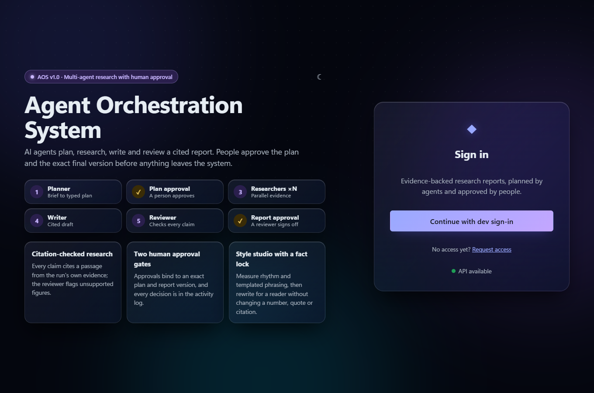

Choose **Continue with …** (for example *Continue with Google*). Sign-in goes through the
deployment's identity provider (OpenID Connect); the app never sees your password. Only
verified email addresses count.

If sign-in does not complete, the page says why and what to do:

| Message starts with | Meaning |
| --- | --- |
| *This account doesn't have access yet* / *isn't invited yet* | You signed in correctly but are not on this deployment's access list. Request access (if offered) or ask a workspace admin to invite your email |
| *Sign-in was cancelled* | You cancelled at the provider |
| *That sign-in attempt expired or was started in another tab* | Start again from this tab |
| *We couldn't reach …* | The identity provider is unavailable; try again shortly |
| *… did not confirm an email address* | Use an account whose email is verified |
| *Too many sign-in attempts* | Wait a few minutes |

If your session ends while you work (it expired, or an administrator removed your access),
the next action takes you back here with *"Your session ended"*. After signing in you return
to the page you were on.

Locally, the dev identity provider offers the demo users Alice (analyst), Bob (reviewer),
Carol (admin, and platform admin in the E2E setup), Mallory (another workspace), and two
unseeded people for trying access: **Dana** (to invite) and **Erin** (to request access).

## Getting access

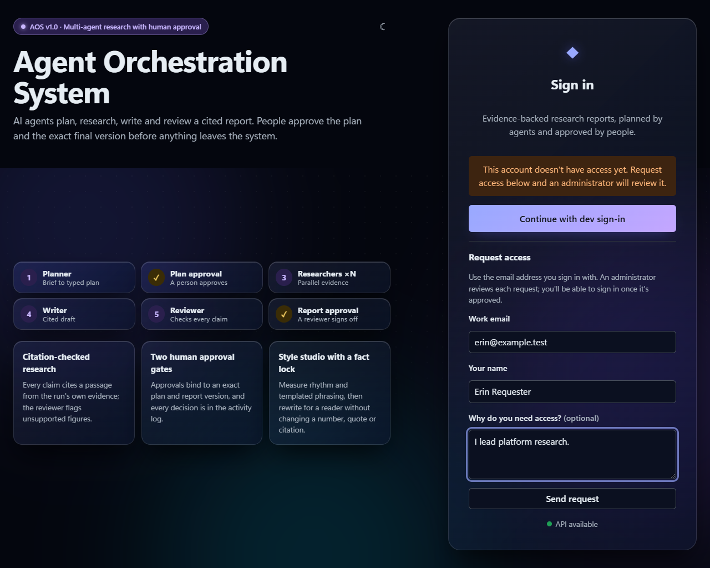

There are two ways in, depending on the deployment:

- **An invitation.** A workspace admin invites your email with a role. Sign in with that
  address and you land in the workspace. Invitations expire after 14 days.
- **A request.** When the sign-in page shows **Request access**, send your work email, name
  and an optional reason. You get the same confirmation whatever happens next. A platform
  admin approves or denies; once approved, sign in with the same email.

Signed in but in no workspace yet? The welcome page lets you **start a workspace** (where the
deployment allows it; you become its admin) or tells you which email to give an admin.

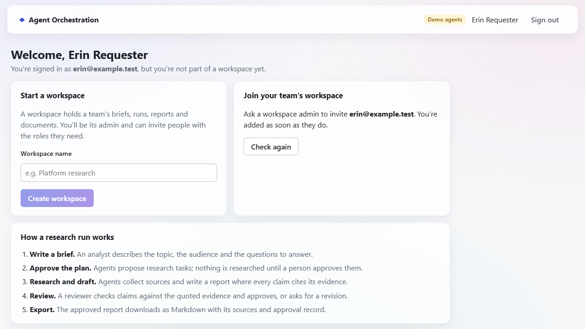

## 2. Write a brief

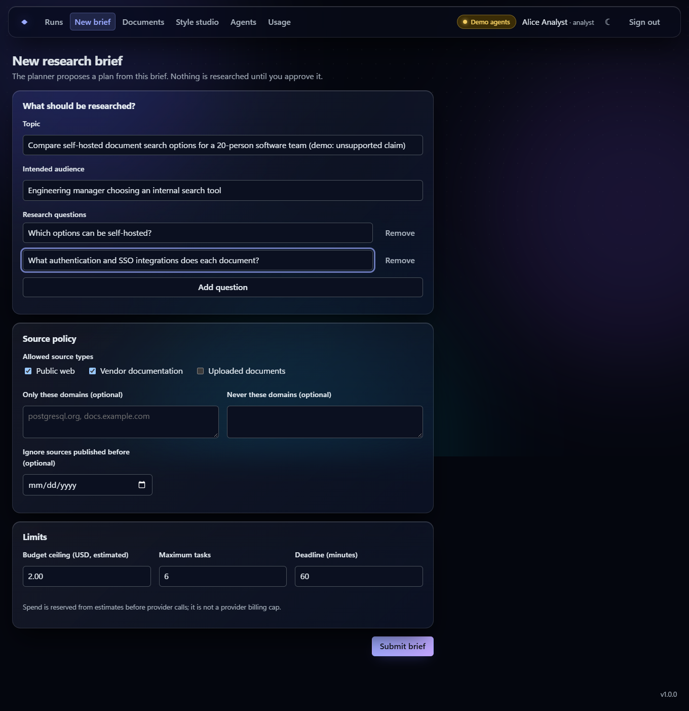

**New brief** asks for:

- **Topic** and **intended audience**: who will read the report and why.
- **Research questions** (1–10): each becomes at least one research task.
- **Source policy**: which source types are allowed (public web, vendor documentation,
  uploaded documents), optional allowed or blocked domains, and an optional publication date
  floor. Agents cannot use sources outside this policy.
- **Limits**:
  - a **budget ceiling** in estimated USD (spend is reserved *before* each provider call);
  - a maximum number of tasks;
  - a deadline.

Submitting twice by accident is safe: the brief carries an idempotency key, so a double click
creates one run.

## 3. Approve the plan

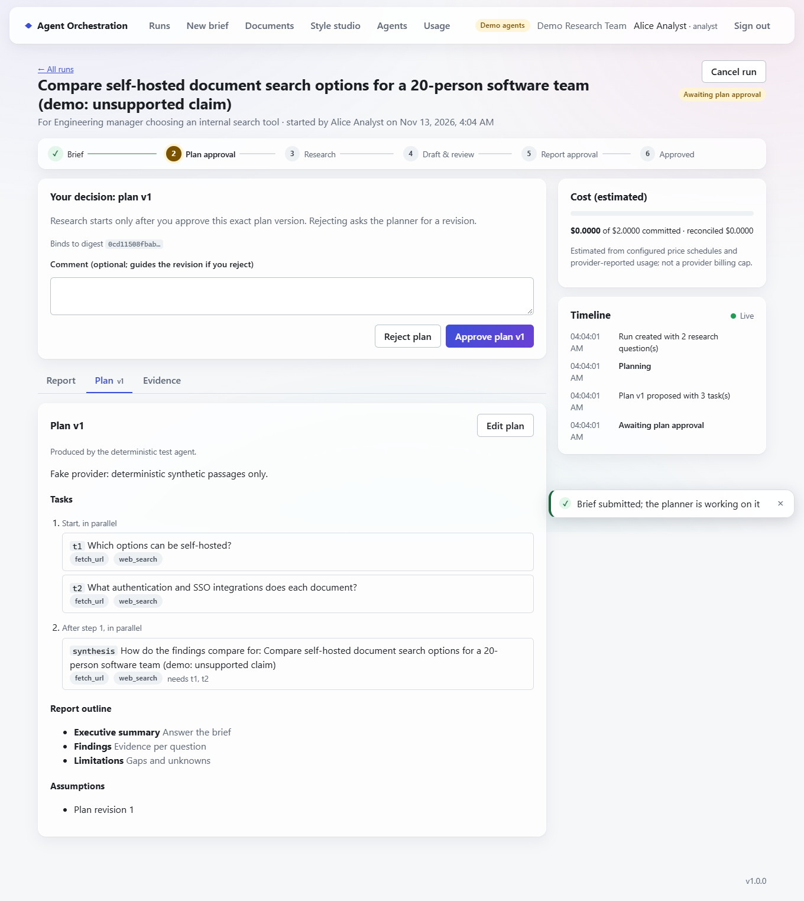

The planner proposes tasks, their order (tasks in the same step run in parallel), the tools
each may use, and a report outline. **Nothing is researched until an analyst approves.**

- **Approve plan vN** binds your approval to that exact version and its digest (shown as
  *Binds to digest*). If the plan changes after you opened it, the approval is refused and
  you are asked to reload.
- **Reject plan** with a comment asks the planner for a revision.
- **Edit plan** lets you change tasks directly; the edit becomes a new version that still
  needs approval.

The progress stepper at the top shows where the run is. The **Timeline** on the right updates
live and can be replayed after a page reload.

## 4. Research, drafting and automatic review

Approved tasks run in parallel. Each collected passage is stored as **evidence** with its URL,
retrieval time, publication date and a SHA-256 content hash.

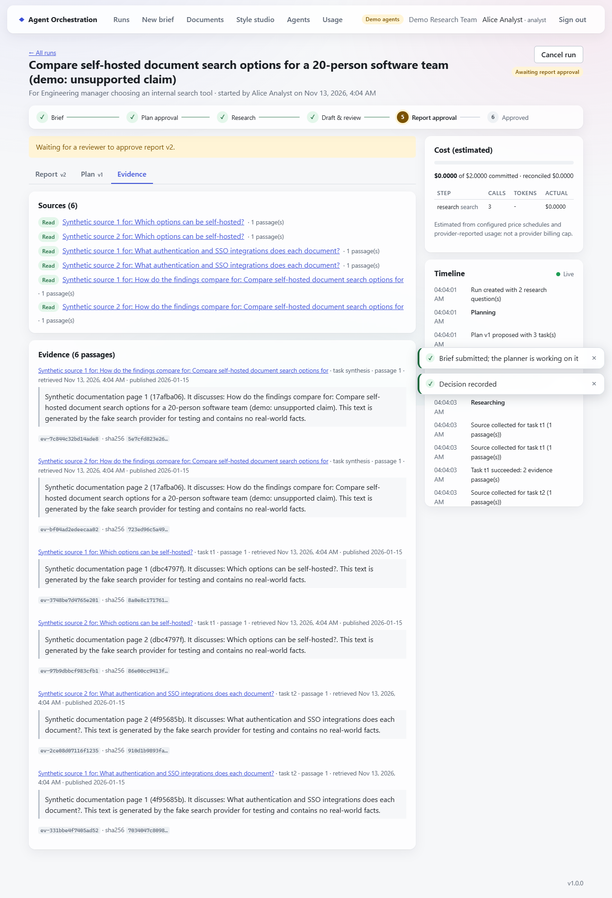

The writer drafts a report in which every statement is labelled **Fact**, **Inference**,
**Recommendation**, **Conflict** or **Unknown**, and cites evidence (`[1]`, `[2]`, ...). An
automatic reviewer then checks the draft. It verifies that the figures and wording in each
claim appear in the cited passages and, when a model is configured, checks meaning as well.
A blocking finding sends the draft back to the writer for a bounded number of rounds.

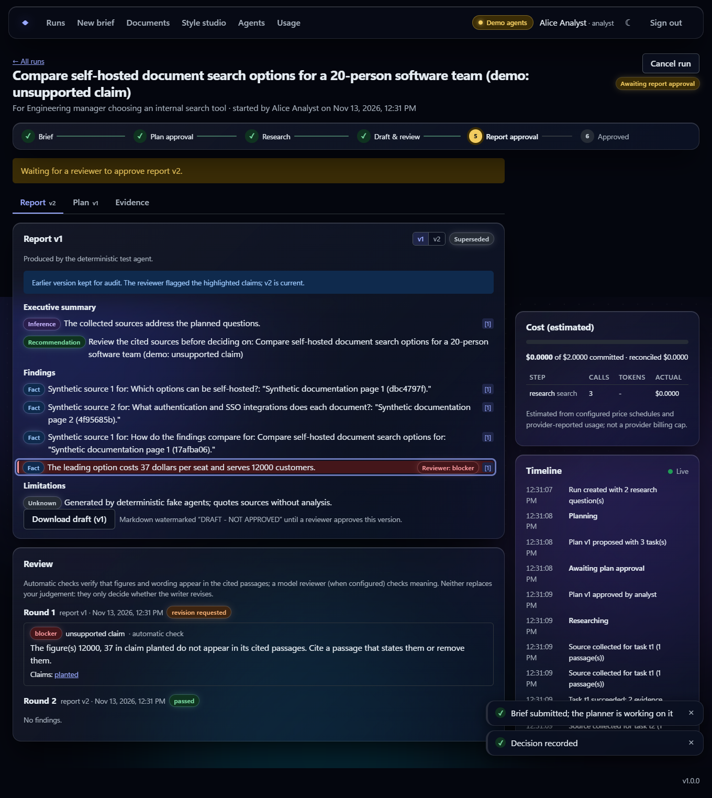

In this demo, report v1 contained a planted claim with numbers that no source supports. The
reviewer flagged it as a **blocker**, and v2 removed it. The **Review** card keeps the
history of every round.

## 5. Approve the report

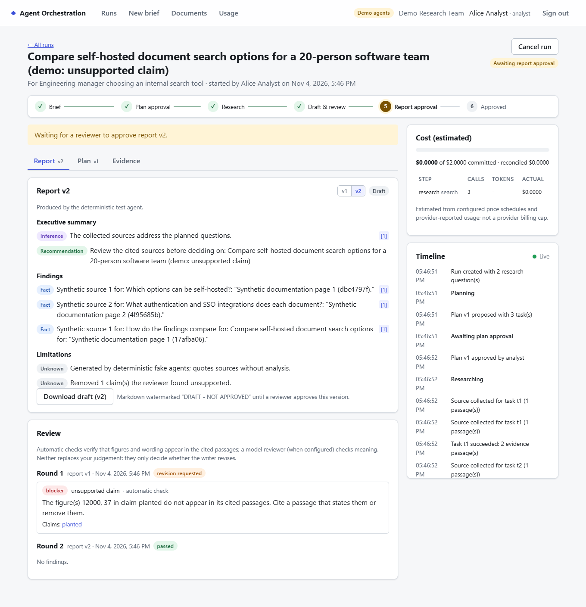

A reviewer (not the analyst) decides on the final report. Click any citation to see the
exact passage it relies on before approving:

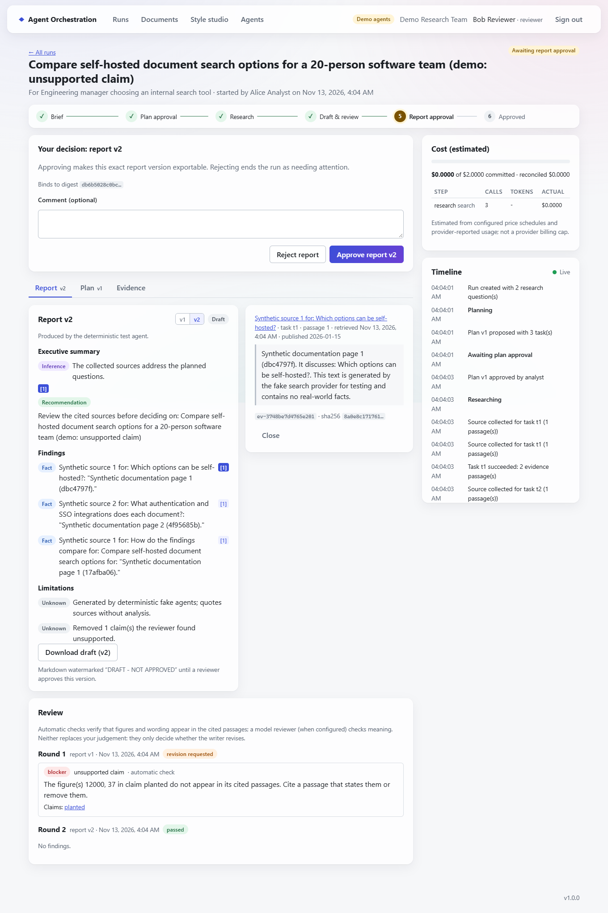

- **Approve report vN** makes that exact version exportable.
- **Reject report** ends the run as needing attention.

Before approval, **Download draft** produces Markdown watermarked *"DRAFT - NOT APPROVED"*.
After approval, the download is the clean, approved version:

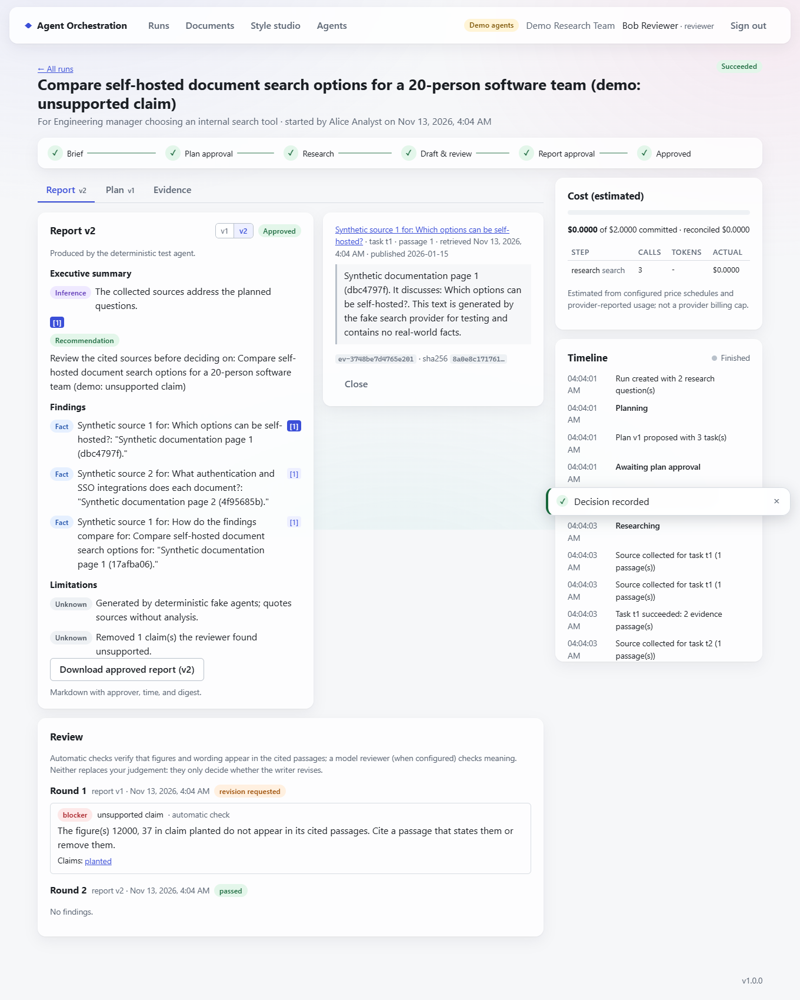

## 6. Runs, usage and activity

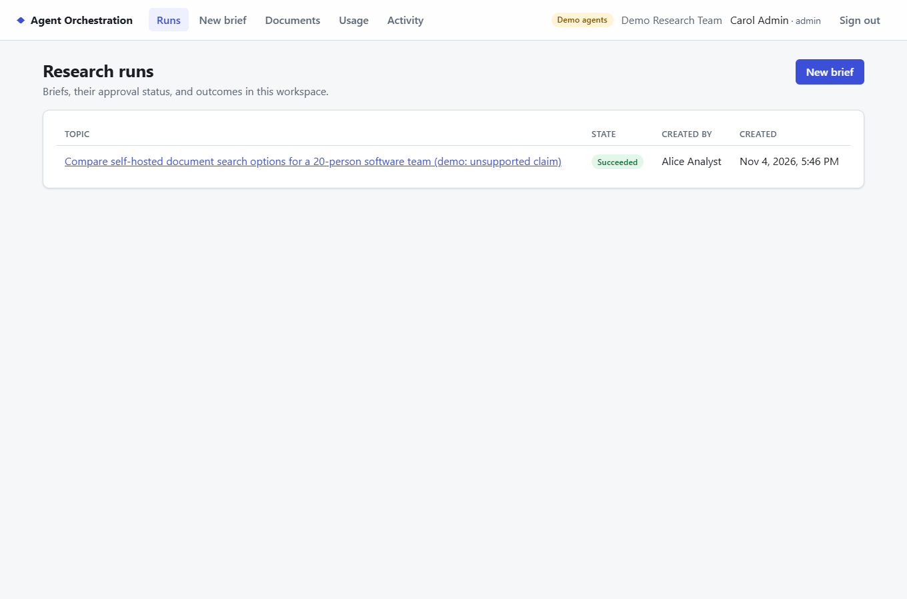

**Runs** lists every run in the workspace with its state. Runs waiting for a decision show
an amber badge. Waiting approvals expire after 72 hours by default; the analyst then
resubmits the brief.

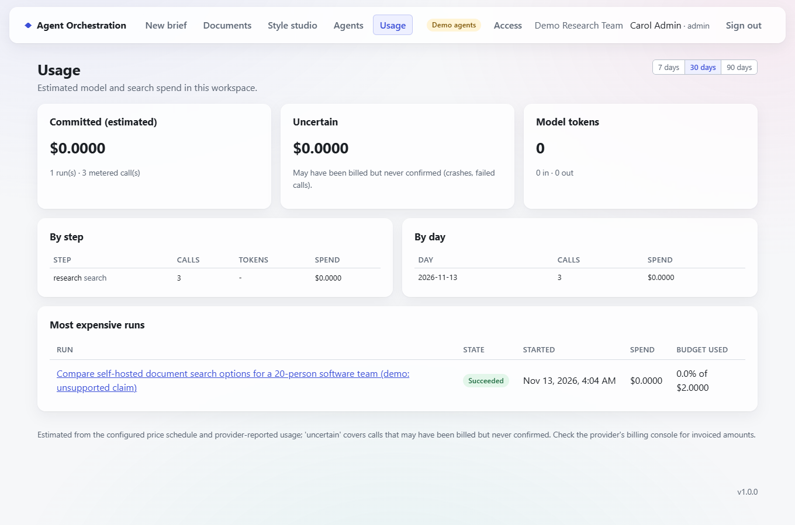

**Usage** (analysts and admins) shows estimated and reconciled spend per run and per
provider. Amounts are estimates from configured price schedules, not a provider bill.

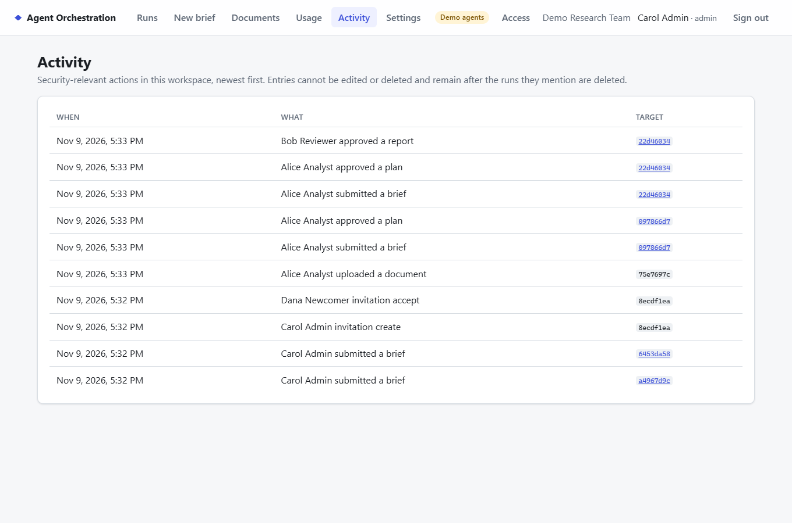

**Activity** (admins only) is the workspace audit log: plan and report decisions, exports,
cancellations, retries, invitations, member changes, uploads and deletions (including
retention clean-ups).
Entries hold ids and counts, never report or source content. A database trigger rejects edits
and deletions, so the application cannot rewrite history. Only a database superuser could
bypass it. Entries remain after the runs they mention are deleted. Sign-in denials belong to
no workspace and are kept only in the deployment-wide audit table.

**How long things are kept.** Runs, reports and uploaded documents stay until an admin deletes
them; nothing expires on the hosted demo. Waiting approvals still expire after 72 hours, and
decided access requests are removed after 90 days. Details:
[data-retention.md](operations/data-retention.md).

## 7. When something goes wrong

| Situation | What to do |
| --- | --- |
| Run is **Failed** | The banner names the step and reason. An analyst can press **Retry from last checkpoint** (up to 3 times); finished work is reused, not repeated. |
| Run is taking too long or is no longer needed | **Cancel run**. A run waiting for a person or in the queue is cancelled at once. A run a worker is processing stops at its next boundary (step, tool call or budget reservation); calls already in flight are still recorded. |
| Run **Needs attention** | The reviewer rejected the report, no evidence could be collected, or the budget ran out outside research. Read the timeline, adjust the brief and submit again. |
| Budget exhausted during research | Remaining tasks are not started and their questions are recorded as unresolved, so the report shows what was not covered. |
| A run must be removed | An admin can **Delete run** once it has finished (cancel it first). This permanently deletes the brief, plan, evidence, reports and exports. The activity log records the deletion. |

See [troubleshooting.md](troubleshooting.md) for setup and error-message help.

## 8. Uploaded documents

**Documents** (analysts) accepts text-based PDF, `.txt` and `.md` files up to 10 MB. The type
is decided from the file content, not from its name or the browser's declared type. Uploaded
documents are used only by briefs whose source policy allows *Uploaded documents*. The
uploader or an admin can delete an upload. Deletion removes the stored file and its
searchable text. Passages already used as evidence in a run stay with that run as part of its
immutable record, until the run itself is deleted.

> **Hosted demo storage.** The hosted demo keeps the text extracted from your document, not
> the file itself: search, evidence and reports use the text, and nothing offers the original
> back for download. Keep your own copy of anything you upload.

## 9. Workspace settings (admins)

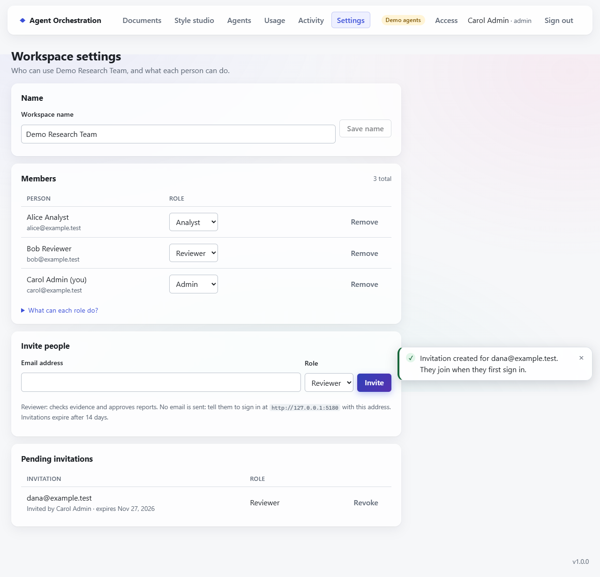

**Settings** lets workspace admins:

- rename the workspace;
- change a member's role, or remove them (you are asked to confirm). A workspace always keeps
  at least one admin; the page explains when a change would break that;
- **invite people** by email and role. Someone who already has an account is added at once;
  anyone else joins the first time they sign in with that address. No email is sent, so tell
  them the address of the app;
- see pending invitations (with their expiry) and revoke them.

## 10. Access (platform admins)

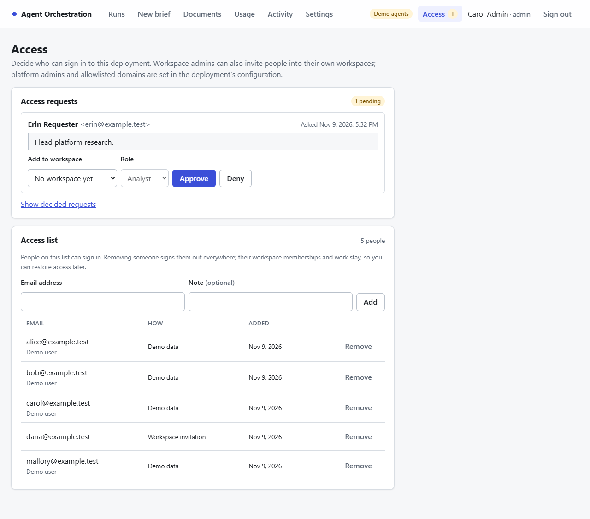

Platform admins see **Access** in the top bar, with the number of requests waiting.

- **Access requests**: approve (optionally straight into a workspace, with a role) or deny.
  Decided requests are listed below and deleted after 90 days.
- **Access list**: the people who may sign in besides platform admins and allowlisted domains.
  Removing someone signs them out everywhere and revokes their pending invitations; their
  memberships and work stay, so access can be restored.

## 11. Mobile, dark mode and accessibility

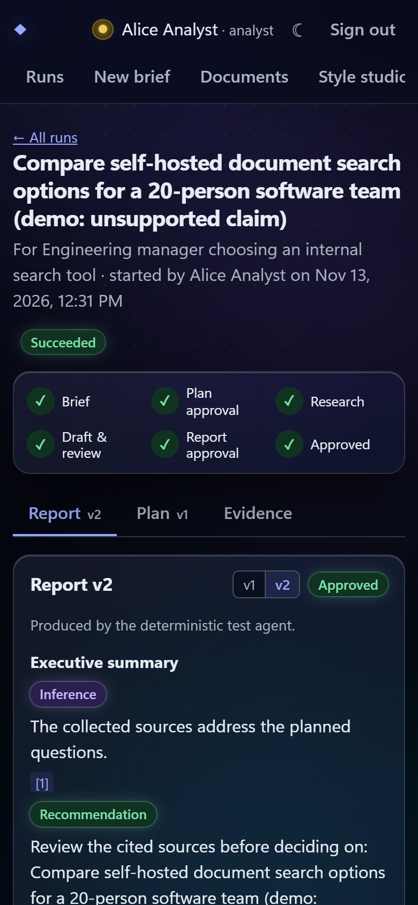

- Every page works on screens 360 px wide: the top bar compacts, the stepper wraps into a
  grid, and tables keep their essential columns.
- **Dark mode** follows your operating system setting, with the same contrast as the light
  theme.

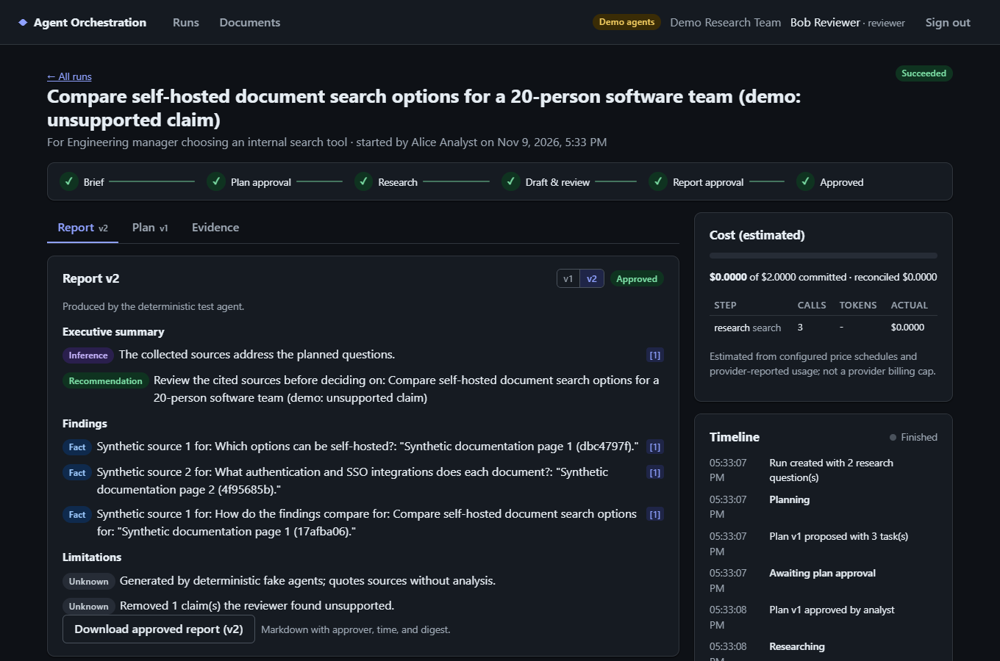

- A **Skip to content** link is the first focusable element on every page, and every page
  sets a descriptive browser title.
- Status uses text as well as colour; animations respect *reduce motion*.
- All controls work with the keyboard. Confirmations take focus, and Escape backs out.
- Notifications appear bottom-right (bottom of the screen on phones). Screen readers
  announce them.
- Every page is checked against WCAG 2.2 A/AA rules with axe-core, in light and dark mode,
  on every test run. Manual screen-reader checks are listed in
  [product/accessibility-checklist.md](product/accessibility-checklist.md).
